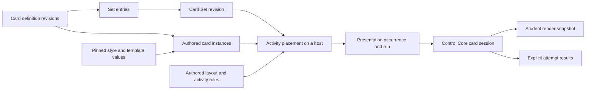
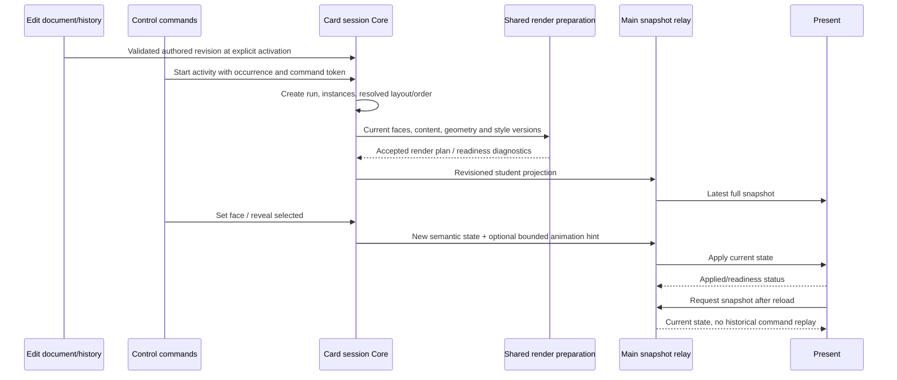
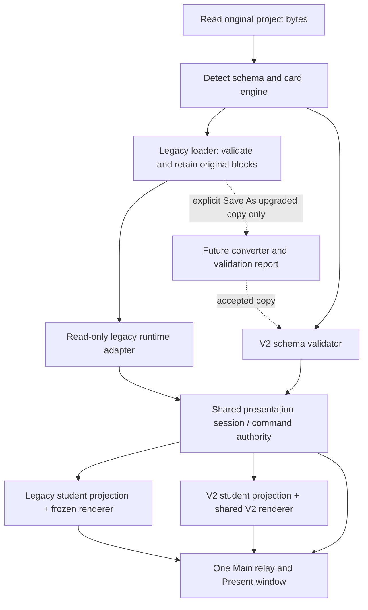

# Story Studio Card System V2 — research and architecture investigation

Date: 7 October 2026 (Asia/Tokyo). Status: **design recommendation, not approval to implement**.

This report investigates the current working tree, including the uncommitted presentation/runtime refactor, and the six numbered production episode candidates. It proposes a future system; it does not change application code, legacy cards, or episode files. No migration tool was built and no production project was opened in the application.

Evidence labels used throughout:

- **[R] Repository evidence:** directly inspected current source; evidence index in [current architecture](D:/AI/GitHub/Story-Studio/docs/card-v2-research/current-architecture.md).
- **[E] Episode evidence:** read-only JSON inventory, field/reference analysis and file hashes; [episode inventory](D:/AI/GitHub/Story-Studio/docs/card-v2-research/episode-inventory.md).
- **[X] External research:** official product documentation or primary research, linked beside claims; detailed [product comparison](D:/AI/GitHub/Story-Studio/docs/card-v2-research/external-products.md).
- **[I] Inference:** interpretation, risk, or feasibility estimate, not verified product internals or observed classroom outcomes.
- **[D] Design recommendation:** proposed behavior requiring future implementation and validation.

The appendices are part of the deliverable. They contain the full source trace, product-by-product A–H comparison, six-episode compatibility matrix, card-level CSV, and machine-readable evidence. An undocumented competitor capability is recorded as unknown, not absent. JSON inspection cannot prove clipping, exact historical appearance, or pedagogical intention.

Audit details and test boundaries are in the [verification record](D:/AI/GitHub/Story-Studio/docs/card-v2-research/verification.md). The [complete card ledger](D:/AI/GitHub/Story-Studio/docs/card-v2-research/episode-card-content.csv), [raw card evidence](D:/AI/GitHub/Story-Studio/docs/card-v2-research/episode-card-evidence.json), [source hashes](D:/AI/GitHub/Story-Studio/docs/card-v2-research/episode-source-discovery.json), and [variant comparison](D:/AI/GitHub/Story-Studio/docs/card-v2-research/episode-variant-comparison.json) make the inventory reviewable.

## 1. Executive recommendation

**[D] Build one compositional card system in the existing application: reusable card content, explicit placements, bounded activities, and a single authoritative session runtime. Keep a small frozen legacy rendering path for existing episodes.**

A Card is a small reusable visual learning object with one or two authored faces. A Card Set is a named, ordered collection of references to those objects. A Card Activity supplies the task: reveal, recall, match, order, classify, choose, or manipulate. A card placement supplies size, location, appearance selection and activity role. The session supplies the current face, concealment, selection, position, attempt and result. None of those live states belong to the reusable content.

The teacher-facing vocabulary should be **Cards, Sets, Activities, Front, Back, Layout and Style**. ACard/BCard remains visible only in an explicitly marked Legacy area. An old ACard is usually a scene/activity container, not a new kind of card. A BCard is closer to a reusable content definition, but its current style and face assumptions need separating.

**[R] Preserve the current architectural progress.** Current `CardRuntime` already separates live movement/flip state from authored instances and feeds student projections. `TeachStateProvider` is no longer the active authority. The old mount-started timer and teaching shuffle/library-mutation findings cannot be repeated as if the refactor never happened. Important remaining problems are implicit activity activation, mixed percent/dimension geometry, incomplete text fitting, unbounded authoring/shared-edit behavior and legacy rendering assumptions.

**[E/I] The six episodes do not justify manual reconstruction or a second application.** Their saved content can be structurally mapped. Their actual activity hosts and identities must be preserved, especially booster-attached cards and intentional-looking duplicated variants. Visual fidelity, answer interpretation and legacy interactions still need teacher review before an optional conversion is considered accepted.

Three approaches were compared:

| Approach | Benefit | Cost/risk | Decision |
|---|---|---|---|
| Extend ACard/BCard indefinitely | Small initial changes; immediate visual continuity | Retains stage/content terminology, editor coupling and mixed geometry; new activities accumulate exceptions | Reject as the long-term model |
| Convert every load to V2 immediately | One renderer sooner | Unproven visual parity; risks changing answer judgments, overlap, blank backs and legacy timing; conversion becomes compulsory | Reject as default |
| V2 domain plus bounded in-app legacy adapter/render path | Clean new authoring; existing episodes remain usable without conversion; gradual opt-in validation | Temporarily two card render paths, but one app, Core, asset system and presentation transport | **Recommend** |

The smallest useful proof is a teacher-controlled **Recall & Reveal** activity: one reusable set, text/image faces, individual/all reveal, duplicate-and-edit, deterministic fitting and an Activation booster placement. Prove a second placement of the same set has independent state. Do not begin with a universal game engine, adaptive spaced repetition, a nested slide editor or migration tooling.

## 2. Current ACard/BCard architecture

**[R] Authored model.** [types.ts](D:/AI/GitHub/Story-Studio/src/shared/types.ts:494) defines project-level A/B libraries. ACards contain stage mode, background, title/questions, typography, timer configuration and BCard instances. BCards contain front/back side configs, optional audio reference and animation preset. Each instance has its own ID, BCard ID, percent center position, absolute width/height, z-index, optional board shell and flags. Slides, break sections and booster sequence items can also own instances; story references can reference ACards. These are already broader than booster-only cards.

**[R] Store and authoring.** `CardStore.tsx` operates on project libraries via callbacks into project state. Legacy editors and sidebars create, duplicate, edit and arrange definitions/instances. A library edit affects referencing placements. Exact duplication and cleanup semantics are documented in the source appendix; they must not be assumed to mean deep-copying all referenced content.

**[R] Current runtime.** [cardRuntime.ts](D:/AI/GitHub/Story-Studio/src/shared/cardRuntime.ts:11) stores per-occurrence instances, face/blur/cover/zoom state and a start anchor. [useCardRuntime.ts](D:/AI/GitHub/Story-Studio/src/renderer/useCardRuntime.ts:13) binds that Core to Control and invalidates delayed commands using occurrence/activation identity. Runtime moves/shuffles do not write the authored library. `ensure` reconciles changed authored instances and prunes removed state. It is not a durable session persistence store.

**[R] Current rendering.** `ACardStageRenderer` renders board background/text/timer plus `StageInteractable`; direct overlays use `BCardInstanceLayer`. `BCardFace` supports text, an image background and a corner emoji. Font size is manual; neither face rendering nor the editor provides the proposed robust text-fit contract. Teach drag uses pointer deltas transformed back to logical coordinates; Edit uses `react-rnd`. Present uses passive render paths. CSS supplies flip, cover, blur, zoom and board framing.

**[R] Current projection.** `App.tsx` constructs an activity scene from definitions and runtime bindings. `usePresentProjection` sanitizes it through `parseActivityScene`; `PresentSnapshotRelay` transports revisioned full state. `present.tsx` renders that projection without creating a competing card runtime. Project metadata and unused libraries are filtered. Both faces of a used legacy BCard can still be present in the projection; student-safe here means whitelisted data, not that an unrevealed answer is absent from the receiving process.

| Ownership now | Examples | V2 consequence |
|---|---|---|
| Authored document | Libraries, placement geometry, face text/style, timer settings | Keep serializable and undoable |
| Control-owned volatile runtime | Instance position after live move/shuffle; flipped/blurred/covered/zoomed; occurrence start | Keep, expand with explicit activity lifecycle and validation |
| Renderer-local visual state | Measured host size, pointer capture, clock ticks, drag suppression, CSS animation | May display state; must not decide semantic order/face/results |
| Legacy/dead-end implementation | `TeachStateProvider`, `BCardInstanceRenderer` without active call sites | Do not use as the basis of the redesign |

**[R/I] Current warning signs, updated:**

1. Teaching shuffle is now authoritative and volatile. It still receives measured logical container dimensions, uses bounded random placement with fallback to old positions, and mixes percent centers with absolute dimensions. A snapshot is consistent; an authored layout is not yet a portable, versioned layout contract.
2. ACard timers now derive elapsed time from the shared occurrence anchor rather than starting independently in each renderer. However, `ensure` is called while constructing a scene, including Edit. “First bound/rendered” is not the same as “teacher started this activity.” Leaving can let elapsed time continue. This is a lifecycle design gap, not the old duplicate timer authority bug.
3. Standalone and embedded boards have different space/backdrop expectations; half-stage content and board shells need preservation.
4. Reusable definition edits and Teach-accessible authoring controls remain distinct from live state commands. A V2 toolbar must make that distinction explicit and keep document editing in Edit.
5. CSS clamping can change where a card appears without changing its saved center. Saved dimensions alone do not recover the historical screen size.
6. Media/audio fields in the schema are not proof that all media behaviors are implemented. Current active BCard rendering does not make an audio reference a working audio interaction.

This investigation does not claim a newly observed live Control/Present failure. It identifies source-supported residual risks, and separately verifies existing runtime/transport tests. The detailed appendix provides file/line evidence and host-specific behavior.

## 3. Existing episode inventory and compatibility corpus

**[E] Six logical numbered episodes were located in the development environment.** Candidate selection follows the numbered production paths, with alternative/test/remake documents reported separately. The inventory records source paths and before/after SHA-256 hashes. Source files were read directly; loading/saving through Story Studio was deliberately unnecessary.

| Episode | ACard definitions | BCard definitions | Main implication |
|---|---:|---:|---|
| 1 | 4 | 31 | Image-rich legacy content and more varied board usage require the broadest compatibility coverage |
| 2 | 1 | 10 | Preserve booster occurrence attachments; board contents are not the complete usage model |
| 3 | 1 | 27 | Same separation between library boards and actual lesson placements |
| 4 | 1 | 24 | Sentence fragments and concealed answers must remain independently manipulable |
| 5 | 1 | 22 | Preserve actual placed variants rather than merging similar text |
| 6 | 1 | 23 | Why/Because choices include a meaningful identity/correctness discrepancy requiring content review |
| **Total** | **9** | **137** | **311 saved BCard instances across all authored host locations** |

The 311 count is not 311 unique learning objects or 311 simultaneously displayed cards: it includes instances in libraries and placements across hosts. The appendix separates board, story and booster ownership and supplies full field/style/dimension statistics, face content, duplication candidates and per-episode converter judgments.

More specifically, **136 placements are inside ACard libraries, 160 are on 90 booster hosts, and 15 are on seven story break-section hosts**. There are zero directly attached story-slide BCards and three saved ACard references (two in boosters and one on a story slide). Episodes 2–6 have no saved ACard reference; their B content is still used through booster placements. Manual board selection is possible and cannot be inferred from saved references.

All nine boards are full-stage; none has an enabled timer. No saved B placement uses the optional board shell. All 274 faces specify Arial, centered horizontal alignment and colors; no emoji or instance flags are populated. There are 29 blank backs, especially Episode 5, and three image-only fronts in Episode 1. Blank faces are meaningful concealment candidates, not errors to fill automatically.

Episode 1 alone has card-media references: 28 face-image, 27 audio and two board-background references resolve to 23 distinct existing asset files. This establishes existence, not decoding or card-audio playback. Episodes 1–2 save animation presets, but current renderer behavior must be checked independently of those fields. The corpus does not exercise half-stage, timer, shell, emoji or non-Arial behavior; preserve those legacy capabilities with synthetic compatibility cases rather than pretending the six episodes test them.

Concrete fit risks include Episode 3's 69×80 grammar cards and a 55-character front at 34px in a 245×135 board placement; Episode 4's 60px text in 80px-high strips; and Episode 6's 174×80 board cards with up to 48-character fronts at 28px. Booster copies often have larger dimensions. These are geometry-based review priorities, **not visually reproduced clipping defects**.

**[E] Crucial discrepancy:** Episode 6’s `activationSequence[9]` references card ID prefix `26f8b2da`, whose “Because he wants to keep the Heart of the forest” back says “Wrong.” Its board library instead uses near-identical ID prefix `52e24e0e` with “Forest” and back “Correct ”. Neither is a dangling reference. A text-deduplicating converter or converter built solely from ACard contents could silently change the answer. Preserve both identities and their actual references; ask for content judgment only in a future explicit conversion review.

**[I] Feasibility:** structural extraction is highly automatable; determining intended pedagogy, historical font/layout fidelity and whether a duplicate was intentional is not. No measured percentage of completed conversion is claimed because no converter was built. “Unused in the six files” is narrower than “safe to delete from all possible legacy projects.”

## 4. External product research and its limits

**[X] The accompanying product comparison covers Quizlet, Kahoot!, Nearpod, Pear Deck, Genially, Wordwall, Baamboozle, Wayground/Quizizz, Canva, Anki, H5P, PowerPoint, Google Slides and an additional relevant classroom-authoring product.** It distinguishes publicly documented behavior, authoring assessment, undocumented text fitting and runtime inference. It records source links and currentness corrections.

The most useful transferable contrasts are:

| Pattern | Evidence anchor | Story Studio decision [D] |
|---|---|---|
| Content can generate several learning views | Anki’s explicit note/card/template distinction; [Anki introduction](https://docs.ankiweb.net/manual/getting-started) | Separate learning content from its placement/activity, without importing scheduling machinery |
| A reusable resource can support multiple bounded exercises | [Wordwall features](https://wordwall.net/pc/features) and documented template compatibility | Reuse Sets through activity adapters; require suitable roles/relations rather than pretending every set fits every task |
| Teacher and projected surfaces serve different purposes | Pear Deck’s documented teacher/projector/student views, detailed in the product appendix | Private Control answers and controls; narrow Present projection; explicit reveal policy |
| Live games benefit from simple teacher orchestration | Baamboozle and Kahoot official authoring/play descriptions in the appendix | Keep group choice/reveal easy; timing and points optional |
| Presentation tools expose distinct fit policies | PowerPoint/Slides official shrink/resize/no-fit documentation in the appendix | Give a clear fit policy and actionable overflow warning, not an unexplained font-size slider |
| Interactive authoring benefits from bounded templates | H5P card, matching, drag and sequencing content types in the appendix | Share card rendering, give each activity a small rules contract |

**[I] Cross-product convergence is evidence of a useful product pattern, not proof that any particular UI improves learning.** Documentation does not establish a competitor’s database model, random seed ownership, persistence algorithm or unpublished minimum font size. Those remain unknown unless explicitly documented, as in Anki’s model.

## 5. Pedagogy: build Activation around an attempt, then feedback

**[X] Retrieval can improve later meaningful learning.** Karpicke and Blunt’s experiment found advantages for retrieval practice over concept mapping in the studied setting, including inference/comprehension questions. It does not validate Story Studio or establish that every flip animation is educational. [Original study abstract](https://pubmed.ncbi.nlm.nih.gov/21252317/).

**[X] Feedback after retrieval helps learners recognize and correct errors; it can be a teacher discussion rather than a graded quiz.** [Retrieval Practice guidance](https://www.retrievalpractice.org/feedback).

**[D] Default Activation sequence:** reconnect to the story → show a prompt/image → allow thinking, speaking or arranging → teacher reveals/checks → discuss the reason → retry or revisit in a changed context. A brief pause is supported, not forcibly timed. A “revealed” card records exposure, not correctness or mastery.

| Teaching intention | Card/activity pattern | Teacher evidence and safeguard |
|---|---|---|
| Recall vocabulary | Image or contextual cue; hidden word face | Teacher hears response before revealing; do not infer success from flip |
| Predict story continuation | Prompt or clue, optional reveal face | Prediction may have several defensible answers; no automatic wrong judgment |
| Transform grammar | Cue plus example response; optional explanation | Preserve alternative valid wording; initially teacher judged |
| Build a sentence | Movable fragments in an ordering/sentence activity | Duplicate words remain distinct instances; punctuation and valid alternative orders supported |
| Match image/word or prompt/response | Explicit relations, not equal-text matching | Explain reasoning; permit distractors only when authored |
| Categorize | Named categories and movable cards | Many-to-many acceptance where appropriate; no color-only categories |
| Collaborative recall | Teacher-led board, selected card, shared discussion | Student ownership/results optional; no automatic attribution to active roster member |
| Recognition/choice | Choices with explicit answer keys and explanations | Recognition is useful but should not replace all production/recall tasks |
| Memory | Pair identity and turn phase | Game memory of locations is different from remembering the language meaning |

**[D] Worth adopting:** content reused in different contexts, explicit prompt/response relations, low-stakes retrieval, corrective explanation, adjustable scaffolding, deliberate student choice, teacher control over timing, and a clear reset/retry.

**[D] Avoid:** points or speed by default; auto-reveal before anyone responds; equating participation with mastery; deducing correct answers from green/red style or the word “Correct”; text matching as a universal language validator; collecting student results merely because a card was clicked. Spaced/interleaved reuse can be teacher scheduled through Sets later; an Anki-like learner scheduler is outside the first product scope.

## 6. Proposed concept and domain boundaries

**[D] Use composition and a few discriminated records, not inheritance or a universal rule language.**

| Concept | Responsibility | Explicitly excludes |
|---|---|---|
| CardDefinition | Versioned reusable faces, label, tags, language metadata | Placement, current side, score, timer, student identity |
| CardFace | A bounded content template and typed slots | Arbitrary nested canvas, scripts, free CSS |
| CardStyle | Named token set, typography and shape/aspect choices | Answer correctness, activity rules |
| CardSet | Ordered entries pointing to definition revisions | Live order, attempts, current face |
| CardInstance | Authored occurrence inside a placement: definition ref, role, appearance override, initial face | Shared mutable state across placements |
| CardActivity placement | Bounded task configuration, instances, relations, layout, initial state | Global lesson navigation or a second media engine |
| CardSession | Authoritative activity/card state for a particular presentation occurrence and run | Persistent reusable definitions |
| Result record | Explicit attempt/judgment with provenance and optional student/group | Inferred mastery from a reveal |

An authored activity initially lives in a **placement** on a lesson host. This avoids requiring a reusable ActivityDefinition library before there is evidence it is needed. Reusable activity presets are templates. Reusing a Set creates new instance identities in each placement; it does not reuse live state.



**Front/back is optional geometry, not a learning taxonomy.** A definition has front only, back only, or both; at least one must exist. Default initial face is the first authored face unless the placement chooses another existing face. A one-face card can be concealed/revealed; it cannot flip into a nonexistent face. The answer may be on either face or another card. Prompt, answer, clue, choice, category and reward are roles in an activity, not subclasses.

**Flip and reveal differ.** `setFace(back)` changes the face. `setConcealment(none)` removes a mask without changing the face. Teacher “Show answer” resolves the activity’s explicit reveal target(s), which might use either operation. “Flip all” means set all eligible cards to a chosen face, not toggle a mixed group into another mixed group. “Flip selected” may toggle one card; a group command names a destination. Reset restores the authored initial face, concealment, layout and task phase.

## 7. Domain/schema design and identity

**[D] Introduce a separately versioned `cardSystem` authored module in a new project format, provisionally project version 5.** Its first schema may be `schemaVersion: 1` even though the feature is marketed Card V2; schema version and product name are different. New-format writing is never an incidental side effect of opening an old project.

The following is a **design example**, not a created project or implementation. IDs are shortened for readability; real IDs are opaque UUIDs generated at creation/import.

```json
{
  "schemaVersion": 1,
  "definitions": {
    "card-forest": {
      "id": "card-forest",
      "headRevision": 1,
      "revisions": {
        "1": {
          "label": "Forest",
          "tags": ["episode-vocabulary"],
          "faces": {
            "front": {
              "layout": "image-caption",
              "image": {"assetId": "asset-forest", "alt": "A forest", "fit": "contain"},
              "text": {"language": "en", "blocks": [{"runs": [{"text": "Where are they?"}]}]}
            },
            "back": {
              "layout": "text",
              "text": {"language": "en", "blocks": [{"runs": [{"text": "They are in the forest.", "marks": ["strong"]}]}]}
            }
          },
          "defaultStyleRef": {"id": "style-clear", "revision": 1},
          "createdFrom": {"templateId": "picture-recall", "templateVersion": 1}
        }
      }
    }
  },
  "styles": {
    "style-clear@1": {
      "shape": "rounded-rectangle",
      "aspect": "landscape",
      "surface": "paper",
      "accent": "teal",
      "border": "strong",
      "padding": "comfortable",
      "typography": {"family": "classroom-sans", "align": "center", "verticalAlign": "middle", "fit": "auto", "min": 28, "max": 48, "maxLines": 4}
    }
  },
  "sets": {
    "set-episode": {
      "id": "set-episode",
      "headRevision": 1,
      "revisions": {"1": {"label": "Episode vocabulary", "entries": [
        {"id": "entry-forest", "definitionRef": {"id": "card-forest", "revision": 1}}
      ]}}
    }
  },
  "placements": {
    "placement-recap": {
      "id": "placement-recap",
      "host": {"kind": "boostItem", "id": "boost-activation-recap"},
      "display": {"kind": "target"},
      "sourceSetRef": {"id": "set-episode", "revision": 1},
      "instances": [{
        "id": "instance-forest",
        "sourceEntryId": "entry-forest",
        "definitionRef": {"id": "card-forest", "revision": 1},
        "role": "prompt",
        "initial": {"face": "front", "concealment": "none"}
      }],
      "activity": {
        "kind": "recall-reveal",
        "revealTargets": [{"instanceId": "instance-forest", "face": "back"}],
        "judgment": "teacher",
        "timer": {"kind": "none"}
      },
      "layout": {"kind": "grid", "frame": {"width": 1280, "height": 720}, "columns": 1, "gap": 24, "padding": 48}
    }
  }
}
```

Host discriminants are `slide`, `break`, `boostItem`, and `boardTarget`; future game/reward hosts use explicit adapters. A target booster item refers to the placement, and validation requires its host/back-reference to agree. Overlay display has a logical rectangle and a host anchor; a target uses the whole activity region. Cyclic placement references and recursive activities are forbidden.

Separate runtime example:

```json
{
  "schemaVersion": 1,
  "sessionId": "session-a",
  "projectActivationId": "open-a",
  "presentationOccurrenceId": "boost-occurrence-a",
  "placementId": "placement-recap",
  "runId": "run-a",
  "revision": 7,
  "phase": "active",
  "cards": {
    "instance-forest": {"face": "back", "concealment": "none", "selected": false, "disabled": false}
  },
  "resolvedLayout": {"instance-forest": {"x": 320, "y": 180, "width": 640, "height": 360, "rotation": 0, "zIndex": 1}},
  "order": ["instance-forest"],
  "timer": {"status": "idle", "elapsedMs": 0}
}
```

A session save, if later enabled, is a separate sidecar/document, keyed to project/content revisions. An optional explicit result would contain `attemptId`, occurrence/run/instance IDs, response, teacher/system judgment, time and optional student/group ID. It is not embedded in the card definition. Do not copy the existing practice of storing other student teaching state in `ProjectData` into the new card module merely for consistency.

**Validation rules:** unique IDs per defined scope; map keys agree with IDs; finite bounded geometry; positive sizes; one/two faces only; initial/reveal face must exist; set/asset/style/host references resolve; instance roles valid for their activity; matching/category relations point to existing members; no dangling answer targets; bounded rich text and slot counts; no executable HTML/URLs; unknown future schema opens read-only with explanation instead of being downgraded. A project may carry both legacy blocks and V2 placements; a placement has exactly one engine discriminator.

**Stable identity and revisions:**

- Definition ID identifies the learning object; revision identifies its exact authored content. Old referenced revisions remain until an explicit unused-revision cleanup.
- Set entry ID distinguishes repeated use of the same definition, including duplicate words. Array index is display order, never identity.
- Card instance ID identifies an authored occurrence in a placement. Two activities referencing the same definition have different instance IDs.
- Runtime key is the tuple `(session, project activation, presentation occurrence, placement, run, instance)`. Use structured tuples/serialization, not ambiguous concatenated strings.
- Re-entering an occurrence resumes the retained run by default; **Restart activity** creates a new run. Project reopen creates a new activation. Stale callbacks include activation/run/revision tokens and are rejected.

## 8. Visual/style system

**[D] Start with strong named presets and limited, visible overrides.** Keep content templates, style presets and activity presets separate. A vocabulary content template must not force a quiz rule or a particular color.

| Teacher choice | Initial presets | Allowed customization |
|---|---|---|
| Shape/aspect | Landscape 4:3, portrait 3:4, square 1:1, sentence strip 4:1, short-label pill | Bounded size/aspect override; pill only when the short content fits |
| Surface | Paper, dark, high-contrast, image-safe | Theme color tokens; opaque text backplate where needed |
| Border/radius | Clear/strong border; square/soft/rounded | A few token choices, not arbitrary CSS |
| Depth | Flat or subtle shadow | Off/on; no shadow as the only readability safeguard |
| Typography | Classroom sans, large text, sentence emphasis | Alignment, bold/emphasis, approved size policy; advanced manual size |
| Status | Selected, hidden, locked, correct/incorrect/needs discussion | Icon/label plus border treatment; never only hue |

Gradient accents are optional, restricted to the frame or tested surface combinations. Avoid busy gradients behind body text. An image background and text overlay require a solid/sufficiently opaque backplate; a shadow alone does not guarantee contrast over a moving video.

Presets resolve to a versioned token snapshot saved with the project. A future theme update offers an explicit preview/update action. It never silently recolors an old lesson. High-contrast and reduced-motion session preferences can alter the viewing treatment without altering the authored content or correctness.

A face may have its own pinned style reference or bounded token overrides, so front and back can differ without duplicating a renderer. Resolve appearance in a documented order: pinned preset → definition default → face override → placement appearance override → temporary accessible/status treatment. No layer can override content or answer keys. Legacy import may retain explicit per-side colors/font values in a compatibility style rather than forcing them into the new preset palette.

## 9. Responsive text strategy and deterministic rendering

**[R] The current card face uses a fixed font size and fixed geometry, with clipping governed by CSS. [D] Replace that with a declared fit policy, one logical frame and one renderer contract.**

### Fit contract

1. Resolve the exact pinned face content, template, style, language and font asset version. Wait for the required fonts/images or report a specific fallback diagnostic. Font loading must be an explicit readiness dependency. [X: CSS Font Loading](https://www.w3.org/TR/css-font-loading-3/).
2. Compute a logical content box after template slots, padding, image area and labels. This is independent of Control panel width or physical monitor pixels.
3. Wrap using the language-tagged text layout, explicit paragraph/line breaks and a fixed line-height. Measure actual rendered rich text, not character count or canvas width alone.
4. Choose the largest fitting font on a fixed half-unit ladder between the preset min/max. A binary search may accelerate candidate selection; validate the final candidate and its next larger neighbor against actual bounds/line count. Cache by content revision, box, font/style/template versions and fit policy.
5. Fit includes all inline boxes, ruby annotations, line height and a small defined tolerance; both scroll extent and rendered fragment bounds matter. Fit a hidden reverse face in a measuring surface rather than a `display:none` box.
6. If the minimum fails: use **approved layout growth** only if the activity permits it; otherwise require an author choice to enlarge, reduce items per page, split content, or use a sentence template. Do not silently make unreadable text smaller or delete learning content with ellipsis.
7. Manual size is a supported explicit mode. It still runs overflow diagnostics and can be switched back to Auto. A manual override applies to a placement style or definition style, with its scope shown.

Initial product values to validate in classrooms: body min 28 logical units, common range 32–48, single-word range 40–72 in a 1280×720 activity frame; label minimum 20, ruby annotation initially at least 18. These are **design starting points, not a universal accessibility-safe minimum**. Actual projected size depends on contain scale, viewing distance and display. Preflight flags final projected body text below a classroom readability threshold; the teacher can choose fewer/larger cards or focused view. The small Control preview has a separate magnifier and never drives a smaller student font.

### Same result in Edit, Control and Present

Use one bundled renderer, pinned font files/fallback order, template metrics and logical geometry. A DOM-dependent **Control render-preparation service** computes a `CardRenderPlan` (content/style hash, slot boxes, font decisions, diagnostics); pure Core owns semantic state, not a DOM measurer. Publish the accepted plan with the projected state. Both surfaces render that plan at uniform scale. Present waits for matching font readiness and reports mismatch/overflow, rather than silently choosing a different size. This is a proposed contract requiring prototype verification; identical browser APIs alone do not guarantee cross-platform pixel equality.

The plan is a derived cache, not authored content and not student progress. Invalidate it on text/style/template/font/geometry revisions, not animation frames. A Present reload uses the latest plan/current face; it does not rerun randomness. Edit sandbox preview uses the same preparation code but does not start or mutate a live session. If live content edits are permitted later, publish a validated revision atomically; do not expose half-edited text to Present.

### Multilingual requirements

**[X/D]** Keep text language per block/run where necessary; support English and Italian accents, apostrophes and whitespace, and Japanese punctuation/line-breaking conventions. Use normal language-aware wrapping rather than `break-all` as a global remedy. Emergency wrapping of unbreakable URLs/identifiers is explicit. Avoid automatic hyphenation in initial language-learning templates so displayed word forms stay intentional. [CSS Text Level 3](https://www.w3.org/TR/css-text-3/).

Represent furigana as structured ruby runs (base text + reading), not inserted spaces or separate absolutely positioned text. Reserve annotation height and test mixed Latin/kana/kanji, punctuation and line-boundary cases. The first schema can reserve this bounded run type even if the first editor does not expose every ruby option. No vertical Japanese layout in the first slice. [CSS Ruby](https://www.w3.org/TR/css-ruby-1/).

Ellipsis is acceptable for a **library thumbnail label**, never the student’s prompt or answer. In Teach, “Focus card” expands into a coordinated reading view without changing the saved layout. A still-unresolved overflow warning must remain visible in Control; no claim of successful fitting is made merely because CSS hides overflow.

## 10. Media and elements inside cards

**[D] Use fixed face layouts:** text, image-only, image-caption, image-with-prompt, and prompt-plus-supporting-text. Each has bounded slots: one main text block, optional supporting label/text, at most one main image/icon, and optional audio affordance. Rich text allows paragraphs, emphasis, language runs and ruby; no nested cards, embedded iframes, arbitrary shapes canvas or executable HTML.

Images refer to the project asset library, with alt text, contain/cover and a bounded focal crop. An icon comes from a bundled stable icon vocabulary or an imported asset. Emoji is allowed as text, but exact appearance depends on the font/platform; use a pinned graphic asset when it carries an essential clue. Decorative elements are template tokens and have no semantic answer role.

Audio is optional face/definition media with an explicit play command routed through the existing audio/media authority. Flip never automatically plays or duplicates audio across Control and Present. A visible affordance and transcript/accessible label identify available audio. Do not adopt the legacy unused audio field as a completed feature. Video stays on the host story scene in the first release; cards may overlay it. A future video-card slot must reuse existing transport and trim semantics and justify its added lifecycle complexity.

Legacy audio references and animation preset metadata remain preserved but inert wherever the current renderer does not execute them. Activating them during conversion would add behavior to Episodes 1–2; that requires an explicit teacher decision, not merely copying a field into a now-functional V2 property.

## 11. Templates and rapid authoring

**[D] Templates create ordinary domain objects.** Vocabulary, picture recall, question/example response, grammar transformation, sentence fragments, category labels, matching pair, memory pair, choice, clue and reward are recipes. A template may generate one or several definitions, a Set and an optional activity preset. It does not introduce a new renderer class per recipe.

Templates define face layouts, initial slot prompts, semantic role suggestions, style defaults, fit policy and compatible activity presets. Content, media, language, style tokens and role assignments can be edited. A template may require a populated slot for a particular activity, but “question/answer” does not force front/back semantics globally.

**Copy resolved values at creation.** Save template ID/version as provenance only. Editing a template affects new creations; an existing card changes only after an explicit upgrade preview. Style revisions are likewise pinned. This costs a little duplicated configuration and avoids a remote template update breaking lesson screenshots or recordings.

| Author action | Identity/reference behavior |
|---|---|
| Duplicate card | New definition ID with copied faces/style refs; no live state copied |
| Duplicate and edit | Same as duplicate; focus primary content and clear selection friction |
| Add another copy to activity | New instance ID referencing the same definition revision; independent runtime state |
| Copy style | Copy allowed style tokens/overrides; no content or identity copied |
| Create N from template | N new definitions/entries, one transaction; editable table of primary fields |
| Duplicate Set | New Set/entry IDs; default copies structure and references, explicitly labelled “reuse these cards” |
| Make independent Set copy | New definition IDs for distinct source definitions, remapped entries/relations; preserve repeated-source relationships within the new Set |
| Duplicate activity placement | New placement and instance IDs; remap instance relations; keep definition refs unless independent-copy chosen |
| Paste into another project | Import referenced assets/styles/revisions and remap colliding IDs transactionally; no absolute machine paths |
| Batch style/reorder | One undoable transaction; order changes do not change IDs |

A spreadsheet-like vocabulary table is useful **later**: explicit front/back/text/image columns, paste preview, language choice, row errors and one undo. Do not start with a spreadsheet engine, AI content generator or automatic semantic deduplication. The observed duplicated answer variants make identity-preserving copying especially important.

## 12. Sets and reuse without shared-edit surprises

**[D] Project-local Sets first.** A Set revision contains stable entries pointing to exact definition revisions. It can be used in a story overlay, Activation, recap or a game. A placement records which entries it materialized and the revision used. It can use all entries or a selected subset; explicit membership is the default. Tag filters may be authored later but their resolved membership is frozen at run start.

The editor shows **“Used in 4 places”** and a usage list before changing shared content. Saving a source edit creates a new definition revision. Offer “update selected uses” with a concrete affected-use preview, or “keep existing lessons on their current revision.” No passive background propagation. Local content variation uses **Make independent copy**, not a hidden content override spread across many instances.

Placement overrides are limited to appearance, role, initial face/concealment and layout. They cannot covertly replace the source answer text. New entries in a Set do not silently appear in an already running activity. **Refresh from Set** updates authored membership/refs as one reviewed, undoable transaction, preserving instance IDs for surviving entry IDs.

Cross-project libraries are a future import/export problem, not a required network service. Package definitions, assets, styles and provenance; imported lessons remain portable and work offline. Shared library subscriptions need a separate product decision if ever added.

## 13. Bounded Card Activities, layout and randomness

**[D] Share a face/instance renderer and command protocol; implement a small reducer/projector per activity.**

| Activity kind | Owns | Does not assume |
|---|---|---|
| Recall & Reveal | Reveal targets, current prompt/selection, optional teacher judgment | Front always contains question; reveal means correct |
| Teacher board | Free movement, selection, reveal/conceal and optional regions | Every card has a scored answer |
| Matching / memory | Explicit relation/pair IDs, attempt or turn state | Equal text identifies pairs |
| Ordering / sentence build | Ordered instance sequence; teacher judgment or authored valid sequences | A single language sentence order is always correct |
| Categories | Category IDs, placement and valid membership sets | Categories are exclusive unless configured so |
| Choice | Choice IDs, allowed correct choices, response and feedback | Color/back text is an answer key |
| Random draw | Remaining/drawn order and discard policy | Rendering an item draws it |

Grid, stack, fan, fixed/free arrangement and deal are **layout/presentation strategies**, not necessarily pedagogical activities. “Flashcards” is a Recall & Reveal preset with next/previous navigation. Drag/select/reveal/lock are capabilities exposed by a given activity, not unconstrained per-card scripts.

Use discriminated layout data. Initial layout kinds: `grid` and `fixed`; add rows/slots and stack when activities need them. Geometry uses one declared logical frame and consistent top-left x/y/width/height units. Recommend 1280×720 for new V2 target activities, with an explicit host-region transform for overlays. Rotation/scale are optional bounded visual transforms; hit testing uses the inverse transform. Responsive display uniformly contains the same authored frame; it does not independently reflow each window. A portrait/wide alternative is an explicit layout variant selected authoritatively.

Layout keeps room for instructions, timer and feedback. If a grid cannot meet size/text minima, use fewer cards per page or teacher-approved enlargement. Dynamic card growth is computed for the activity as a whole, so growing one card cannot independently push neighbors in Present. Fixed/free boards diagnose overlap but preserve deliberate layering. Drag to a slot has a click-select/click-destination equivalent.

**Randomness:** Core alone chooses/records a seed and algorithm version when the teacher starts, shuffles or draws. Store both the resolved order/layout and seed metadata in session state. Present consumes the resolved result, not the random generator. Separate “Shuffle order,” “Shuffle positions,” and “Restart with new shuffle.” A bounded packing algorithm must return a fit/failure result and use a deterministic grid/last-valid-layout fallback with a Control warning; do not silently leave some cards in colliding positions after a nominal success. Retry and recovery use the saved realization, even if the algorithm is upgraded later.

For matching/memory, shuffle visible positions without changing pair IDs. For a sentence exercise, shuffling does not overwrite the answer order. For repeated identical words, instance IDs preserve independent movable tokens.

## 14. Story, booster, board, game and reward integration

**[R]** Current `resolvePresentationTarget` already distinguishes slides, breaks, boards, prompts and activities, with stable occurrence identity. **[D]** Extend that vocabulary through adapters instead of routing every individual card as a target.

| Surface | Integration |
|---|---|
| Story slide/image | `cardPlacements` reference(s) on the existing host; overlay region follows declared scene or viewport anchor |
| Video | Same host overlay, optional authored cue activates it via Core/media time; seeking has explicit cue reconciliation, not mount triggers |
| Activation/language booster | `cardActivityRef` sequence item targets a placement, or placement overlays a slideRef item |
| Standalone board | Activity placement occupies the existing target stage; uses shared navigation/drawing infrastructure |
| Game | Game session owns game rules and turn/result state; embeds card instances/projector and submits typed card commands through the same authority |
| Reward/badge | Reward system owns award/idempotency/student attribution; card provides visual content/reveal, never awards itself on animation end |
| Final Boss | Future game/activity host composes Sets; no special Card subclass or separate engine now |

Anchor policy must be explicit: `scene` cards move with story zoom/pan; `viewport` cards remain fixed as lesson UI. In the first overlay slice default to viewport for prompts, with scene anchoring deliberately chosen in Edit. Layer bands are part of the scene contract: background media → cards → temporary card focus → configured drawing overlay → reward/movement overlays. Existing drawing-above-stage behavior should be preserved unless the teacher selects another supported layer policy.

Video play/pause remains media authority’s responsibility. A card’s reveal can request pause through a named teacher/activity command only when authored; mounting the card never steals playback. Cards cannot own a second video player, drawing surface or navigation cursor.

## 15. Core / Control / Present and lifecycle

**[D] Keep “Core” a state/command responsibility, not a demand for a new process.** The current Control-owned TypeScript runtime is a suitable starting point. Main continues to relay/recover validated projections. A later process extraction is independent of the card redesign.



Commands carry session/project activation, occurrence, placement, run, command ID and expected revision (or a documented ordering sequence). Core validates capability and referenced instance/face, rejects stale/duplicate commands, and publishes one atomic update for group reveal/reset. Control preview uses the same command route as toolbar actions. Present has no navigation/randomization/semantic initialization authority. A future touch display sends validated intent back to Core; it does not locally decide correctness.

**Lifecycle:** authored → preview sandbox → ready → active → paused/completed. Start activity is explicit. Navigation to an activity may issue a Core activation command under a documented user setting, but render/measurement never activates a run. Default V2 timer: disabled; when enabled, starts with the activity Start command, pauses on leave, resumes on return. An explicitly authored “continue while away” policy is allowed. Reset clears attempts, feedback, highlights, selection and positions, restores initial faces/concealment/order, and returns timer to idle; “new shuffle” is a separate action. Exit does not delete authored data.

Timer state is `{status, accumulatedMs, startedAt}` owned by Core. Renderer ticks only calculate display from the anchor. On suspend/resume or system-clock jumps, Core reconciles the chosen elapsed-time policy; do not trust repeated `setInterval` counts. Present reload catches up to the authoritative time. Control/process restart starts a new session unless the user explicitly restores a validated session sidecar; Present-window recovery and full-application recovery are different promises.

**Content visibility:** projectors select only current student-visible faces/feedback, required media and semantic accessibility labels. Teacher notes, answer keys and student identifiers stay in Control/Core. A flip may include a transition’s previous visible face; it need not transmit every hidden answer. This is a useful narrowing over the legacy projection and protects future student-device extensions without requiring them in the first slice.

## 16. Animation and accessibility

**[D] Semantic state is committed first; animation is a bounded hint.** Suggested initial choices: instant, short flip (around 220 ms), fade (120–180 ms), and restrained deal/slide (under 300 ms). These values are product defaults for testing, not learning-science findings. Shake for incorrect answers should be optional and never humiliating; a labelled explanation is more useful. Reserve celebratory effects for the reward system.

Animation hints have event ID, destination state revision, duration and start time. A renderer animates only a fresh compatible transition from a state it actually displayed. Reload/late join renders the current side immediately; it never runs a historical queue. Rapid flip commands cancel/rebase to the newest state. Reduced-motion uses instant/fade and the same semantic result. Group reveal is one state transaction, even if a decorative stagger is used. Sounds are explicit media events with deduplication, not CSS/animation callbacks.

**[X/D] Readability requirements:** target at least 4.5:1 contrast for text, even where the large-text minimum could be 3:1; use opaque backplates on complex imagery. This adopts the documented WCAG thresholds as a baseline, not a claim of full product conformance. [W3C contrast guidance](https://www.w3.org/WAI/WCAG22/Understanding/contrast-minimum.html).

Keyboard selection, activation, face commands, reset and movement alternatives need visible focus and predictable order. Dragging needs a non-drag pointer alternative in addition to keyboard support. [W3C dragging guidance](https://www.w3.org/WAI/WCAG22/Understanding/dragging-movements). Expose only the visible face to accessibility APIs; a covered answer cannot remain in its accessible label. Status uses text/icon as well as color. Alt text describes an instructional image without accidentally supplying an answer that the visual prompt withholds; the author chooses an equivalent accessible prompt where necessary.

Editor/control panels must survive 200% text resizing; the projected stage needs readable focus/enlargement options rather than shrinking every card to preserve a dense grid. [W3C resize-text guidance](https://www.w3.org/WAI/WCAG22/Understanding/resize-text.html). Offer reduced motion regardless of OS preference, and honor the OS setting by default. [W3C animation guidance](https://www.w3.org/WAI/WCAG22/Understanding/animation-from-interactions.html).

## 17. Edit workspace experience

**[R]** `EditWorkspace.tsx` currently docks existing controls through portals without moving ownership of authoring state. **[D]** Add a cohesive Cards surface within those existing workspace regions; do not replace the whole workspace just to implement cards.

The teacher starts with **Add Cards → template or existing Set**. The library shows card faces, language/tags, used-in count and a clear shared-content marker. A Set editor supports reorder, multi-select, duplicate-and-edit and batch style. The central preview uses the same logical render plan as Present. The inspector offers **Content / Appearance / Activity** as contextual sections: face editor and media first, preset/fit controls second, task-specific rules only when relevant.

Face editing shows Front and Back side by side, with Add/Remove face and initial-side control. A one-face card previews reveal without inventing a blank answer. Template slot boundaries are visible; no raw object IDs. Fit diagnostics sit next to the affected text with concrete fixes: “Use fewer cards per page,” “Enlarge card,” “Switch to sentence layout.” Copy-style and duplicate-content are different named actions.

Activity editing selects a task, Set/subset and layout, then asks only for that task’s relations: reveal face, matching pairs, category membership or correct choices. Drag arrangement edits authored layout and is one undo transaction on release. Preview has a separate disposable run and a Reset preview control. It never starts the live board timer or changes a live student judgment.

Saving shared content displays its impacted uses and revision update choice. Removing a referenced definition offers remove usages or cancel; it cannot quietly leave dangling references. Import/paste shows errors before applying any partial batch. All authored changes use existing project-history/save boundaries.

## 18. Teach workspace experience

**[D] Contextual commands, not a permanent wall of buttons.**

| Current context | Primary controls | Secondary controls |
|---|---|---|
| Recall & Reveal | Start, select card, Show answer/Hide answer, next/previous | Reveal selected/all, focus, restart |
| Board | Select, move, conceal/reveal | Arrange/shuffle, lock, highlight, reset layout |
| Matching/memory | Select pair, check/resolve, next turn | Reveal support, retry/reset |
| Ordering/categories | Select/move to slot/category, check or teacher judgment | Undo last move, show example, reset |
| Choice | Select choice(s), submit/check, reveal explanation | Retry, show all choices, next prompt |
| Timed activity | Start/pause/resume timer | Restart timer; duration editing stays in Edit |

Selection in Control is private until the teacher uses Highlight. Highlight is shared state and may differ from selection. “Lock” prevents movement/activation as appropriate to the activity; “Hide” is a student-visible omission, while “Conceal” retains an unidentified card. Live drag changes session layout only. A drag must not also flip; pointer-cancel and lost-capture paths have defined behavior.

A compact status line shows activity phase, current item, timer and Present readiness. No prompt is considered delivered merely because Control displayed it. Errors such as missing media or fit failure remain visible to the teacher, with a safe student-facing placeholder. Live controls do not show A/B terminology or low-level IDs.

## 19. Legacy loading and bounded compatibility

**[D] Default to the existing renderer path through the same Core/Control/Present shell.** Freeze its feature set; isolate critical correctness fixes. New V2 authoring cannot create legacy cards. Existing legacy content may be inspected and preserved, with explicit legacy maintenance/edit behavior decided separately; opening must remain possible without conversion.



The legacy adapter may normalize an **in-memory view** for runtime, but keeps source version/raw legacy card blocks separately so an unrelated save cannot serialize accidental V2 conversions. Current `normalizeProjectData` already normalizes older projects to version 4 in memory; V2 must not mistake that precedent for permission to silently upgrade card content. Unknown fields need lossless retention in the source representation, with only valid/needed values exposed to runtime.

No automatic migration on Open, no font/style reinterpretation on app update, no auto-deduplication, no automatic inferred answer keys. A mixed document uses an explicit legacy/V2 placement discriminator. Project saves must preserve untouched legacy subtrees, and ordinary opening/teaching must leave original bytes unchanged. A future mixed-format Save As must clearly explain its file compatibility before writing.

### Behavior classification

The complete actual-use matrix is in the episode appendix. The categories below describe proposed compatibility routes, not proof that unbuilt V2 code already passes them.

| Legacy behavior | Class and route | Reason / review |
|---|---|---|
| Text/media face payload, stable definition/instance refs, repeated content | **1 — exact semantic/data mapping** | Preserve text, whitespace, IDs/provenance and references; exact pixels are a separate acceptance claim |
| Front/back swapping and independent instance reveal state | **1** when mapped explicitly | Do not assume question/front or answer/back; blank backs remain real blanks until reviewed |
| Solid colors/basic rounded rectangles and font choices into new presets | **2 — visual difference only** under opt-in modernization | New padding, fit, crop or typography can change screenshots even with identical words |
| Existing implicit elapsed timer into explicit Start/pause-on-leave | **3 — minor behavior difference**, only with consent | Preserve legacy timing by default; V2 defaults are intentionally different |
| Blur/cover/zoom into conceal/focus/scaffolding controls | **3** if generalized; **4** for exact legacy visual interaction | Mask versus blur reveals different information; no silent substitution |
| Percent-center/absolute-size layout, host-dependent clamping, overlap, board shell and half-stage composition | **4 — use legacy renderer for default visual preservation** | Missing historical viewport means a new frame cannot guarantee identical output; future fixed-layout mapping remains possible |
| Ambiguous answer meaning, inconsistent variants, missing assets if found | **5 — manual conversion review where semantics cannot be inferred** | Review is not blanket manual rebuilding; keep working legacy content unchanged |

“Class 4” does not mean these behaviors are impossible in V2. It means the safe no-conversion loading route today is the retained renderer until equivalence is demonstrated. “Class 5” does not justify modifying the source to resolve uncertainty.

### Policy A versus B

| Policy | Benefits | Risks | Recommended use |
|---|---|---|---|
| A: preserve visuals | Familiar teaching cues, recordings/screenshots, placement/cover behavior | Keeps old text-fit flaws and some visual limitations | **Default legacy opening**; preserve baseline renderer behavior as closely as current assets/fonts allow |
| B: preserve semantics with modern visuals | Better readability/presets; unified V2 authoring | Reflow/crop/overlap change; spatial clues or revealed hints may alter teaching | Explicit upgraded copy with side-by-side review |

Absolute “exactly as ever recorded” visual fidelity cannot be promised without the old app/font/display baseline. Establish a reference build and viewport corpus first. The recommended default preserves current accepted legacy behavior, not a fabricated historical pixel guarantee. There is no evidence that two independently maintained applications are necessary.

## 20. Optional migration feasibility and review

**[E/I]** Use the per-episode matrix to plan work; the saved source is sufficiently structured for mechanical extraction. Feasibility by episode:

| Episode | Structural mapping candidates | Automation estimate and required review |
|---|---:|---|
| 1 | 4 boards, 31 definitions, 64 placements, 3 A refs | Mostly automatic structure; review image crops, Japanese, separate Heart-answer composition and legacy styling; preserve duplicate IDs |
| 2 | 1 board, 10 definitions, 20 placements | Mostly automatic; verify clue context, transformation text and each host's geometry; do not activate previously inert animation metadata |
| 3 | 1 board, 27 definitions, 54 placements | Mostly automatic; review dense/tiny board versus large booster geometry and multi-card pronoun groups |
| 4 | 1 board, 24 definitions, 77 placements | Mostly automatic teacher-board/reveal mapping; preserve repeated “ing” instances and six blank backs; answer ordering requires explicit authoring |
| 5 | 1 board, 22 definitions, 52 placements | Mostly automatic; preserve 21 blank backs, repeated caption occurrences and sequence order; no inferred answers |
| 6 | 1 board, 23 definitions, 44 placements | Mostly automatic raw mapping; manually review the one conflicting correctness pair before introducing scored-choice semantics |

Across these categories, **460 structural records/reference entries** are candidates for mechanical mapping; booster host containers/order are additional preserved structure. There is no evidence requiring a full manual rebuild of any episode. There has also been **no executed or visually validated V2 conversion**, so these estimates must not be presented as a conversion success rate. For unchanged teaching all six stay on the legacy path; manual review applies to voluntary modernization, not opening them.

The recurring converter recipes are:

| Observed/source pattern | Future converter recipe | Expected automation boundary |
|---|---|---|
| BCard definition | Copy front/back exactly to legacy-compatible face/style revisions; preserve source ID in provenance | Fully mechanical payload extraction; media/font validation |
| ACard with content/background and children | Activity/board target with instruction region, background and fixed child instances | Mostly automatic; frame/half-stage/text region review |
| Cards on a booster slideRef/prompt/breakRef | Overlay placement on that **sequence occurrence**, not on the source slide globally | Mechanical host mapping; verify backdrop/layering |
| Multiple refs to a definition | One content identity, independent instance IDs/runtime | Mechanical; do not merge different definition IDs by equal text |
| Positioned BCards | Fixed-layout placement using a declared conversion frame and source percent positions | Mostly automatic; visual comparison required, clamping preserved or flagged |
| Sentence fragments | Teacher board initially, optionally upgraded to ordering with explicit answer sequence | No reliable automatic answer-order inference from positions alone |
| Correct/Wrong backs or colored choices | Reveal activity initially; offer candidate choice key in a review report | Manual approval before introducing answer validation |
| Repeated vocabulary/recap cards | Candidate named Set with source entry IDs preserved | Grouping suggestion only; do not deduplicate semantic variants |
| Board-style shells / blank reverse faces / blur cues | Preserve through legacy renderer, or explicit equivalent preset/control | Visual and behavior review |

**[D] Future workflow:** select **Convert Card System → Save As upgraded copy**; show source path/hash and destination; copy assets; construct new authored data; validate every reference/face/media and host occurrence; generate a report with exact/visual/behavior/manual categories; present side-by-side screenshots and navigation sequence; keep original file and legacy block backup. Write the completed new file atomically only after validation. Failed conversion leaves the source and active legacy project usable. Rollback is opening the original; in-place downgrade is not required or promised.

Conversion acceptance is per placement and episode, not a single “137 cards converted” counter. Preserve all source identities and original text in provenance. Any approved content correction, such as Episode 6’s conflicting judgment, is a separately recorded author edit after extraction. Never call an automated extraction a pedagogically validated conversion.

## 21. Concrete module architecture and flows

**[D] Follow the existing `src/shared`, `src/renderer`, `src/main` structure.** These are proposed files, not files created in this investigation.

```text
src/shared/cards/domain.ts             definitions, faces, refs, sets, placements
src/shared/cards/schema.ts             versioned parse/validate; no rendering
src/shared/cards/authoring.ts          pure duplicate/import/revision transactions
src/shared/cards/layout.ts             logical grid/fixed/slot resolution
src/shared/cards/activities/           bounded activity configuration + reducers
src/shared/cards/session.ts            activation, commands, timer, run state
src/shared/cards/projection.ts         visible face/state whitelist and revisions
src/shared/cards/legacyAdapter.ts      non-destructive legacy runtime view
src/renderer/cards/CardFace.tsx        bounded face layouts and semantic markup
src/renderer/cards/CardSurface.tsx     shared visual state / animations
src/renderer/cards/renderPlan.ts       font-ready DOM measurement; derived plan
src/renderer/cards/CardActivity.tsx    render an activity projection
src/renderer/cards/editor/             library, set table, inspector, templates
src/renderer/cards/CardControls.tsx    contextual Teach controls
src/renderer/useCardSession.ts         thin Control binding, replacing no globals
```

Keep legacy files in `src/renderer/acards/` initially to avoid churn; route them through a named compatibility boundary. Do not immediately move/rename every file. Existing seams to extend: `types.ts`, `presentationSession.ts`, `presentationSnapshot.ts`, `activityScene.ts`, `App.tsx`, `usePresentProjection.ts`, `present.tsx`, `EditWorkspace.tsx`, `TeachLiveControls.tsx`, and main project load/save. Share media resolution and drawing/scene transforms; do not duplicate them inside cards.

**Editing flow:** inspector action → typed authoring transaction → project history → validated authored module → same render-preparation preview → explicit save. **Persistence flow:** version detect → lossless source retention/strict V2 parse → authored graph → atomic save to permitted format. **Runtime flow:** target resolve → placement activation → Core run → layout/face state → accepted render plan → student projection → existing relay → passive renderer. **Results flow:** explicit teacher/activity judgment → separate result store; never back into definitions.

## 22. Suggested implementation phases

**[D] This is a staged architecture roadmap only. No phase is authorized for execution by this investigation.** It uses the writing-plans skill’s dependency/risk/verification structure; detailed executable task plans should be created for the approved slice, not speculative implementations of every advanced activity.

| Phase | Scope / code affected | Main risk | Required tests / exit gate | Compatibility and rollback |
|---|---|---|---|---|
| C0: baseline and legacy boundary | Corpus manifest, source hash checks, current `acards`, load/save and snapshot contract tests | Choosing wrong episode variant; freezing already changed behavior | All six paths confirmed; read-only hashes; capture accepted viewports/actions; no-save opening test | Existing default path unchanged; remove diagnostic wiring if needed |
| C1: domain and authored schema | New `shared/cards/domain`, `schema`, `authoring`; `types.ts`; main loader | Accidental implicit upgrade; overlarge schema | Round trips, unknown versions, duplicate IDs, missing refs, deep-copy semantics, lossless legacy save tests | V2 feature gate; older project stays legacy; new-format output only explicit new/copy |
| C2: render/text vertical prototype | Shared face/surface, renderPlan, style assets, logical layout | Fonts/ruby/overflow divergence across windows | Golden text/media corpus; identical accepted plans; late font/error behavior; 4:3/16:9/portrait display contain | Sandbox synthetic project only; no legacy CSS replacement; disable V2 surface |
| C3: session and projection | `session`, first activity reducer, `projection`; existing relay/parser extension | Duplicate authority, stale commands, hidden answer leakage | Command token/revision tests, two instances/hosts, deterministic shuffle, group atomicity, reload no replay | Legacy projection variant retained; feature flag and versioned parser revert |
| C4: useful authoring + first booster slice | Library/Set/face editor, duplicate, Recall & Reveal, `cardActivityRef`, Edit/Teach docks | UI hides shared edits; new target disrupts story checkpoint | Author → duplicate → save/reopen → teach → return to story; history undo; image/text fit; two-window recovery | One V2 synthetic/new episode; all six legacy corpus unchanged; disable V2 entry creation |
| C5: reuse and host overlays | Set refresh/subsets, placements on stories/videos/boards; drawing/media adapters | Source edits propagate unexpectedly; video seek/zoom/layer conflicts | Pinned revision and “used in” tests; same set in two hosts; seek/navigation restores proper occurrence | Host integration flags independently reversible; retained authored revisions make rollback understandable |
| C6: advanced bounded tasks | Matching/memory, ordering/categories, choice, random draw, game adapter | Universal rules engine scope; invalid language judgments | Per-activity invariant/attempt/reset tests; explicit relation keys; teacher override; alternative valid answers | New activity discriminants only after support; older app refuses unsupported format rather than flattening |
| C7: optional copy migration | Future converter/report in separate tools/module; Save As and source backup UI | Visual or correctness changes disguised as successful migration | All six conversion fixtures; identity/ref fidelity; source hashes; screenshots; explicit manual flags; failure rollback | Entirely opt-in; original source unchanged; stop using converted copy to roll back |
| C8: legacy retirement decision | Compatibility diagnostics and project inventory, not automatic deletion | Breaking dormant episodes or exported copies | All required legacy behaviors represented; teacher-accepted copies of all six; documented external legacy load path and rollback | No date-based removal; retain loader or read-only legacy rendering while supported files still need it |

C1–C4 form one approved vertical-slice program; a renderer-only demo is not its completion criterion. C2 can inform schema refinement before persistence is frozen. C5 does not invent Sets for the first time: it expands the minimal local Set already used in C4. C7 follows proven behavior, never precedes it.

## 23. First implementation slice and testing strategy

**[D] Recommended slice:** a new synthetic Activation booster containing six picture/phrase retrieval cards, using one project-local Set, optional front/back, image + text, a pinned high-contrast preset, auto-fit diagnostics, duplicate-and-edit, individual and all reveal, reset, and a second placement reusing the Set. Initially teacher judged; no score or automated correctness.

The teacher can create the Set, duplicate/change a card, add the activity, present it, wait for a response, reveal, reset and return to the story. Control preview and Present use the same content/geometry/fit. Reloading Present retains the face and position; the second placement remains independently unrevealed. Save/reopen preserves authored content but does not restore an old live run unless session restore is explicitly selected. That demonstrates pedagogical use, authoring relief, reuse and architectural reliability together.

Scope excludes live cross-project libraries, arbitrary nested elements, audio/video inside card faces, scored games, student devices, adaptive scheduling, converter tools and legacy restyling. An unexposed optional ruby schema run should be tested if accepted into C1; a full ruby authoring UI can follow. Do not silently postpone image text fitting, duplication, persistence or two-window recovery: those are core proof requirements.

| Test family | Concrete acceptance examples |
|---|---|
| Schema / portability | Reject unsupported version or missing face; round-trip non-ASCII text/ruby; resolve packaged images/fonts; retain untouched legacy fields |
| Identity / duplication | Duplicate definition has new ID; linked instance shares content revision but not live state; cloned set remaps relationships; repeated identical words remain distinct |
| Authoring / history | One duplicate/multi-style/import transaction undoes cleanly; shared edit shows all impacted uses; cancel leaves refs unchanged |
| Text fit | English long word, Italian accents, Japanese punctuation/ruby, empty text, explicit newlines, image-caption, minimum failure, font-load delay, manual size warning |
| Front/back / reveal | Front-only, back-only, both faces, initially concealed, answer on front, reveal-selected/group atomicity, forbidden flip to missing face |
| Layout / movement | Logical coordinate round-trip; 16:9, 4:3, ultrawide/portrait displays; Control scaling; bounds/overlap; drag does not flip; lost capture safe |
| Randomness | Fixed seed produces fixed result for its algorithm version; Present consumes no randomness; packing failure has deterministic fallback; reset vs reshuffle distinct |
| Consistency / reload | Same logical plan/face/order in Control and Present; stale/missing/reordered packet recovery; Present reload no animation replay; font mismatch reports an error |
| Lifecycle / timer | Preview never starts; explicit start; leave/return pause policy; reset idle; clock/suspend behavior; old occurrence command rejected |
| Multi-instance reuse | Same definition twice in one activity and in two hosts has independent face/selection/position; updating a source revision changes only selected pinned refs |
| Privacy / results | Hidden answer keys and teacher notes absent from student payload; revealing does not award a result; explicit judgment records correct occurrence/student scope |
| Host integration | Video seek and overlay cue reconcile; story return checkpoint; drawing above cards; reward command idempotency; no second media authority |
| Legacy corpus | All six open read-only; hashes identical; every source ref resolves/diagnostic preserved; accepted screenshots/actions per host; no auto-create V2 blocks |
| Future conversion | Each source definition and occurrence accounted for; E6 conflict retained/flagged; original bytes/assets unchanged on success/failure; no text-based semantic merge |

**[R] Verification performed in this investigation:** TypeScript test compilation succeeded into a temporary directory outside the repository’s generated outputs. Existing card runtime and presentation session tests passed (30); presentation snapshot tests passed (12) after supplying the repository dependency lookup for the temporary build. The first snapshot-test invocation could not resolve `typescript` from that temporary directory; that was a harness location issue, not a product regression. Total: **42 existing focused tests passed**. These verify current behavior only. No V2 code exists, no converter was tested, and no new visual parity or classroom-usability result is claimed.

## 24. Risks and decisions requiring approval before implementation

| Risk | Evidence | Mitigation / acceptance boundary |
|---|---|---|
| Mistaking a legacy board for the whole activity | [E] Cards directly attached to booster occurrences; E6 different answer variant | Inventory all hosts; preserve exact identity/reference topology |
| Hidden semantic conversion | [E/I] Blank backs, choice labels, duplicate variants | Preserve by default; explicit teacher review of activity interpretation |
| Geometry drift | [R] Percent centers + absolute sizes + measured logical frames and clamp | Fixed V2 frame; legacy retained; conversion frame explicit and reviewed |
| Typography mismatch | [R/X] Manual legacy sizing; font readiness and multilingual layout | Pinned fonts, shared measured plans, bounded auto-fit, diagnostics and corpus tests |
| Overscoped authoring | [I] Many requested patterns can become a second slide editor | Bounded slots, compositional presets, one useful slice |
| Shared edit surprises | [R/E] Library references and duplicated variants | Pinned revisions, usage previews, explicit independent copy |
| Runtime authority regressions | [R] Refactor has already established occurrence/snapshot boundaries | Extend existing command/session projection; no renderer init/random/timer authority |
| Legacy maintenance never ends | [I] Exact visual preservation competes with modernization | Freeze features, isolate boundary, per-episode acceptance gates; no arbitrary retirement deadline |
| Documentation overclaim | [X] Competitor text fitting and internals often undocumented | Label unknown/inference; prototype our own contract |

The following are the concrete product decisions to approve or amend **before a future implementation request**. They do not block this completed research phase:

1. **Legacy default:** preserve current accepted legacy visuals in the same app; modernize only an explicit copied project. Recommend yes.
2. **Reuse semantics:** pinned content/style/Set revisions, visible usage impact and explicit update of selected uses. Recommend yes; reject invisible live propagation.
3. **First slice:** Recall & Reveal with image/text, duplication, local Set reuse and one Activation target plus an independent second occurrence. Recommend yes.
4. **Layout and typography:** stable 1280×720 logical V2 frame, fixed templates, minimum-aware fit and no student-content ellipsis. Recommend yes, with font values validated through the prototype rather than treated as final.
5. **Lifecycle:** explicit Start, default pause on leaving, return resumes retained run, Reset returns idle; current legacy timing preserved separately. Recommend yes.
6. **Assessment:** teacher judgment first; answer keys explicit in later activities; reveal never implies correctness or student mastery. Recommend yes.
7. **Legacy editing boundary:** new episodes create V2 only; existing legacy cards retain clearly labelled maintenance editing until conversion is accepted, without adding new legacy features. Recommend this over immediately making all old content uneditable.
8. **Media scope:** images/icons and bounded rich text first; audio through existing authority later; video remains a host. Recommend yes.

## 25. Explicit answers to the product questions

| Question | Recommended answer [D] |
|---|---|
| What is a Card? | Reusable, revisioned visual learning content with one/two bounded faces |
| What is a Card Set? | Ordered, revisioned entries referencing cards; reusable without sharing live state |
| What is a Card Activity? | A bounded task over independently identified instances, with its own rules/session |
| Are front/back universal? | At least one face; either side or both allowed; no mandatory question/answer meaning |
| Prompt/Answer types? | Activity roles and explicit reveal/answer relations, not renderer subclasses |
| Flip/reveal? | Explicit face destination and independent concealment; group actions atomic; reset restores authored initial state |
| Text fit? | Shared font-ready logical render plan, bounded auto-fit, growth only with layout consent, actionable failure |
| Images/icons? | Typed asset slots, contain/crop, accessible description; optional pinned icons/emoji treatment |
| Styling? | Named versioned presets and limited token overrides |
| Templates? | Creation recipes copying resolved defaults; explicit upgrade, no silent inheritance |
| Duplication? | New content identity for duplicate card; new instance identity for another linked use; named independent-copy option |
| Layout? | Authored grid/fixed/slot contract in logical coordinates, uniformly scaled on each surface |
| Randomness? | Core resolves once per explicit command, stores order/layout plus seed/version |
| Story/video use? | Placement overlay on an existing target; host owns navigation/media and coordinate anchoring |
| Game use? | Common card instances/renderer; bounded game reducer owns turns, rules and judgments |
| Persistence? | Versioned authored module, exact refs and pinned styles; session/results stored separately |
| Old A/B survival? | Read-only load adapter and frozen in-app renderer under the existing presentation shell; optional converted copy later |
| Authoring? | Cards/Set library, face inspector, templates, duplicate-and-edit, usage preview, shared visual preview |
| Live control? | Contextual teacher commands routed to one Core, passive Present, explicit lifecycle and recovery |

The design decision is to make cards a reusable lesson primitive and activities their pedagogical context, while treating legacy compatibility as a deliberately bounded loading/rendering responsibility. The six existing episodes remain usable without rebuilding them by hand.
