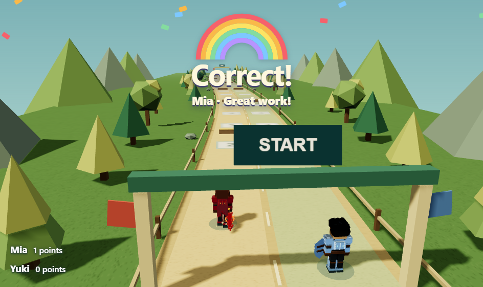
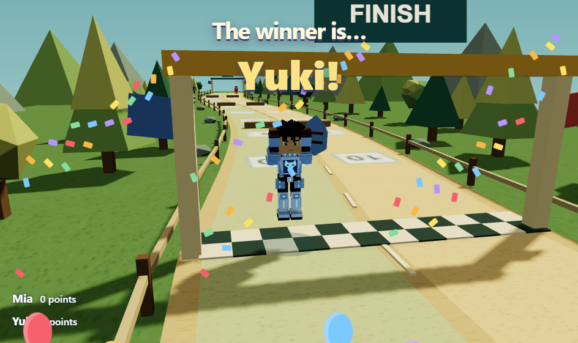

# Hero Dash visual rewards

Positive **Correct +1**, **Excellent +2**, **Bonus +3** and positive prepared-question awards now show a rainbow **Correct!** banner, the rewarded hero's name and colorful confetti. The banner remains while the hero runs to the new checkpoint. On arrival, the hero raises both arms and jumps three times.

A positive award that reaches the finish starts a larger ceremony after the hero physically arrives. The camera moves to the front of the winning hero for roughly ten seconds, with raised-arm jumps, confetti, balloons and **The winner is… [name]!**. It then returns to the selected race view and zoom. The teacher can reset, undo or advance levels without waiting for the ceremony.

Retries, zero-point awards and manual position changes do not trigger Correct. Manual finish adjustments also remain neutral. Reset, undo and level changes cancel the applicable effects. Reduced-motion preferences suppress hopping, continuous camera orbit and moving particles while retaining the reward text.

Effects are presentation-only and add no points or automatic movement. Particle counts are bounded, and timers, animation frames and scene resources are released when the game closes.

## Verification

- 601 shared tests passed, including positive-award detection, retry/manual/undo exclusions and three-hop timing.
- Renderer type checking and main/renderer builds passed; the existing Vite chunk-size warning remains.
- Native Electron playtest covers +1/+2/+3 rewards and three completed hops, Blue's reward, reset cancellation, Yuki's arrival-triggered winner camera, ten-second duration, portrait layout, zoom restoration, undo and neutral manual finish.
- Focused code review completed; its manual-finish observation was addressed.

[Native results](hero-dash-rewards-evidence/results.json)

Run: `node scripts/hero-dash-rewards-smoke.cjs`

Physical classroom hardware performance was not benchmarked. No deployment or installer was produced.
