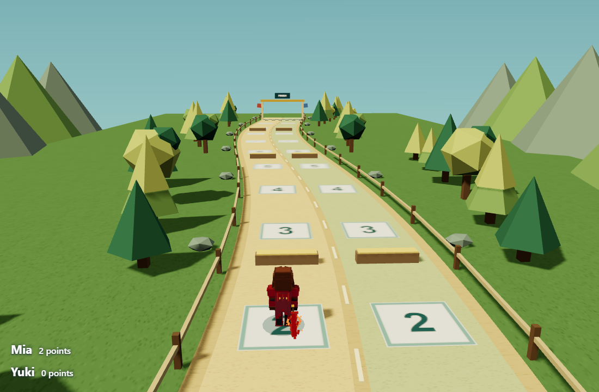
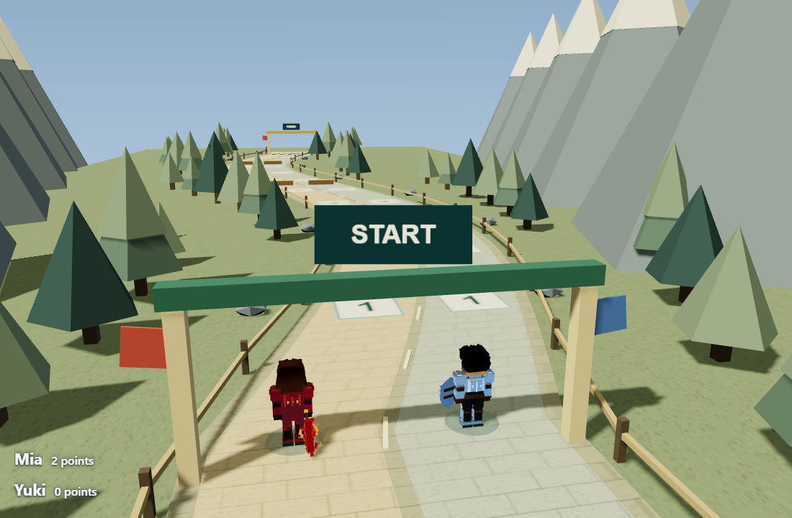
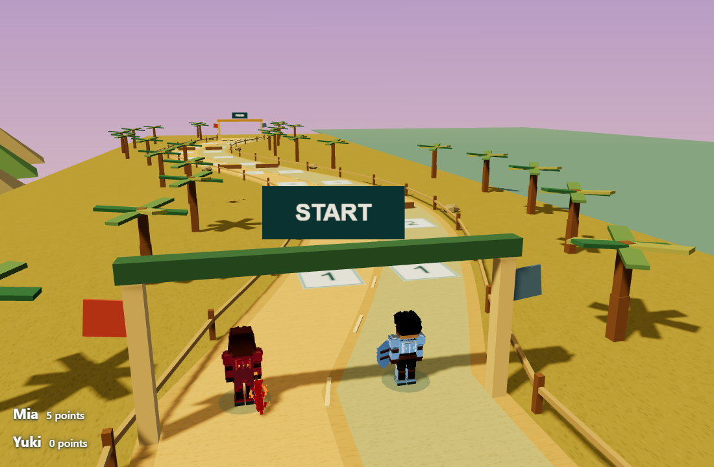

# Hero Dash: visuals, zoom and levels

Implemented in Story Studio. Restart the app to load the updated main process and preload connections.

## Use

- In Control, open Camera views to adjust Race zoom (65–180%) or reset it. Scroll over the Presenter race to zoom directly. Question overlays keep their own sizing. Resizing the Presenter preserves zoom; wider windows reveal more scenery.
- In the image library, use Ctrl/Cmd-click to toggle images or Shift-click to select a range. Select all and Clear selection are also available. Prepare selected adds separate question cards in source order and preserves existing cards.
- Before starting, choose 1–6 levels in Race settings and select a course for each. Available courses are Enchanted Forest, Alpine Mountains and Sunny Coast. Finish a level, then choose Next level. Points carry forward; undo can restore the preceding level. Saved review collections retain the course settings.
- Mia and Yuki use the actual procedural models from the local Blocky World project. That source project was left unchanged.

## Visual changes

Curved courses now have textured track surfaces, varied trees, course-specific terrain and scenery, warm lighting, sky gradients and ground contact shadows. Alpine courses include snow-capped mountains; coastal courses include palms and water. Decorations are bounded and textures are shared/disposed with the scene.

## Verification

- Shared suite: 596 tests passed.
- Game checks: 62 tests passed.
- Main build, renderer type check and renderer build passed. Vite retains its existing chunk-size warnings.
- Native Control/Presenter smoke passed with zero page errors: batch selection/preparation, Control and wheel zoom, wide/portrait resize, all three levels, cumulative points, saved course configuration, media persistence, question/camera layout and existing race controls.
- Focused code review found no important defects.

[Native results](hero-dash-refinement-evidence/results.json)

Physical camera/microphone operation and performance on older classroom laptops were not benchmarked. No deployment or installer was produced.