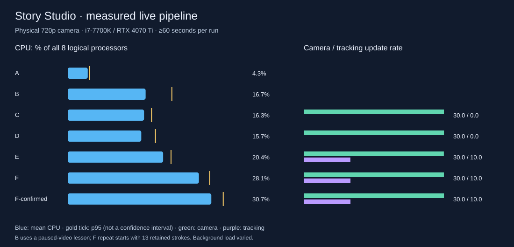

# Story Studio live presenter performance investigation

Date: 12 October 2026. Scope: measurement and decision only; no optimization, audio routing change, schema change, or Phase 3 implementation.

## Executive summary

**Decision: GO WITH CONDITIONS for Phase 3.** Physical-camera processing held about
30 FPS, including lesson-video playback and drawing. Default tracking delivered
about 10 updates/s; actual inference averaged 31–37 ms in the default-rate motion
runs. The combined lesson averaged **28.1% of total CPU capacity**, and a heavier
repeat averaged **30.7%**, on this eight-logical-processor machine. Current desktop
performance is usable; a broad camera/Presenter rewrite is not justified.

The strongest efficiency opportunity is **the existing paused lesson-video / live
teacher-preview path**, not chroma key. A same-instance comparison measured **5.7%
CPU for a static scene versus 15.1% for a paused video**. The teacher preview's frame
counter continued advancing at **28.5 frames/s while the source remained paused at
time zero**. This warrants a targeted follow-up, preserving audio and seek/resume.

The hat's lower smoothness has a concrete cadence explanation: new poses arrive at
~10 Hz and are held between results while the camera draws at 30 FPS. A diagnostic
20 Hz target still achieved only ~15 Hz. Keep the current tracking default and
bound Phase 3 work off the renderer thread; do not assume untested local language
models or lower-spec laptops have the same headroom.

## Architecture and ownership

| Component | Owner / execution | Actual path |
|---|---|---|
| Window lifecycle, files, private camera settings/status relay | Electron main process | `src/main/main.ts`, `presentWindow.ts`, `cameraBroadcast.ts` |
| Lesson/session state, teacher controls, audible lesson mixer | Control renderer main thread; Chromium audio service | `lesson/LessonApp.tsx`, `CameraControls.tsx`, `FaceTrackingControls.tsx`, `audio/AudioManager.ts` |
| Student story, text, cards, transitions, drawings | Presenter renderer; DOM/CSS, 2D canvas, Chromium compositor | `present.tsx`, `lesson/SceneSurface.tsx`, `StaticScene.tsx` |
| Physical camera | Presenter owns one video-only stream; Chromium video capture utility services device | `camera/CameraLayer.tsx`, `shared/cameraSession.ts` |
| Camera texture submission and shader | Presenter main thread submits; WebGL2 runs on GPU | `camera/CameraEffects.ts` |
| Keying, spill, brightness, contrast, mirror | One shader pass, full capture resolution | `CameraEffects.ts`; camera canvas is a sibling of story layers |
| Frame admission and bitmap resize/transfer | Presenter main thread | `tracking/FaceTrackingSession.ts`; max dimension 640, one in-flight frame |
| Face inference | Dedicated worker in Presenter renderer; CPU/WASM/XNNPACK | `tracking/face.worker.ts`, local MediaPipe 0.10.32/model |
| Pose filtering / hat geometry / debug drawing | Presenter main thread, separate transparent 2D canvas | `shared/faceTracking.ts`, `tracking/drawTracking.ts` |
| Lesson file video decode | Presenter-owned HTML video, Chromium decoder services | `PresentVideoScene.tsx` |
| Teacher live video preview | Existing local WebRTC from Presenter's decoded source; Control receives muted frames | `presentationMediaBridge.ts`, `usePresentationMedia.ts` |
| Lesson video audio | Presenter source-only Web Audio graph → existing local bridge → Control mixer | Existing audio routing unchanged |

MediaPipe is a **thread workload inside the Presenter process**, not a second
Electron process. Its inference wall time is measured independently, but process
CPU totals include all Presenter threads and cannot be labeled “MediaPipe CPU”.
The GPU process's CPU consumption is likewise **CPU driver/compositor work**, not
GPU utilization. OS and Electron process snapshots are retained in the evidence.

Source inspection found one webcam acquisition owner, one tracking worker per
active tracking session, one in-flight inference, and explicit stream/worker/GL
cleanup. Camera settings and pose refs avoid per-frame React state updates.
Tracking status is deduplicated before being sent privately to Control. Hidden
camera placement pauses draw/inference but intentionally retains capture.

The existing `PassiveDrawings` loop clears/repaints its canvas every RAF even when
drawings are empty or static. Both teacher and student surfaces can own that loop.
This is a concrete source observation; savings from changing it have **not** been
measured, and it has not been changed. The normal camera also uses `texImage2D`
every processed frame. Neither observation alone proves a bottleneck or leak.

## Methodology and limits

- Actual physical **UGREEN HDMI Capture** input, negotiated **1280×720 at 30 FPS**.
  The user participated with real head motion. No fake-camera flags, portrait
  animation, or prerecorded face source were used for the accepted measurements.
- Intel i7-7700K, four physical cores/eight logical processors; RTX 4070 Ti using
  ANGLE/Direct3D 11; approximately 48 GiB RAM. Electron 34.5.8 / Chromium 132.
  Multiple displays and unrelated applications remained active.
- Presenter content size 1280×720, device scale 1; Control 1280×900. Camera placement
  lower-right, mirror off, brightness 0, contrast 1, tolerance .42, softness .12.
- One disposable lesson: 1280×720 background video test pattern and a text overlay.
  Video was paused for A–E, playing during F. Drawing used 13 scripted strokes in
  F. The first cadence sweep retained those 13 strokes; the final cadence test
  recreates them. The lesson is synthetic test content; **the camera is physical**.
- Each accepted configuration has a 10-second warm-up and at least 60 seconds of
  continuous sampling. This is a modest representative composition, not a claim
  about every large lesson, game, meeting app, or multi-hour session.
- A separate optimized diagnostic build was produced by in-memory Vite transforms.
  Normal source, build configuration, and production scheduler are unchanged.
  Diagnostic callbacks are installed only in the disposable benchmark instance.
- CPU sampled approximately once per second using this instance's
  `app.getAppMetrics()`. Calculation:
  `100 × Δ cumulative CPU seconds / Δ wall seconds / 8`.
  Thus **12.5% of system capacity equals one logical processor fully occupied**;
  multiply reported percentages by eight for the “one processor = 100%” convention.
  Other Electron apps are excluded. Overall OS CPU is reported separately to expose
  background contention. [Electron CPU measurement reference](https://www.electronjs.org/docs/latest/api/structures/cpu-usage/).
- Memory is summed per-process private bytes and working set. Private bytes are
  committed private memory, not necessarily resident RAM. Summed working sets can
  double-count shared pages; they do not include all VRAM. The first suite's
  post-video memory should not be compared to a fresh process as proof of a leak.
- Camera delivery uses `requestVideoFrameCallback` / `presentedFrames` deltas.
  Camera processing counts actual compositor submissions. Presenter RAF frequency
  measures callback opportunities, **not physical screen scanout FPS**.
  [Video frame callback semantics](https://developer.mozilla.org/en-US/docs/Web/API/HTMLVideoElement/requestVideoFrameCallback).
- Actual inference duration brackets only `detectForVideo` in the worker.
  Admission-to-result age additionally includes frame preparation, transfers,
  scheduling, and delivery. First-paint age ends after overlay draw submission.
  Admission timestamps are RAF timestamps, not camera sensor exposure times;
  **sensor-to-photon and true tracking-to-screen latency were not measured**.
- GPU upload/draw queries sample once per second, read asynchronously, and reject
  disjoint results. They include the camera texture upload/draw region, not all
  Chromium compositing, rasterization, video decode, or other applications.
  CPU submission timings are labeled separately.
  [GPU timer query semantics](https://developer.mozilla.org/en-US/docs/Web/API/EXT_disjoint_timer_query).
- Main-thread stalls use Long Tasks and RAF gaps. No claim is made that every stall
  was caused by the camera or MediaPipe. Process CPU includes diagnostic collection
  overhead; no zero-overhead calibration or controlled clean-boot benchmark was run.
- Physical motion, lighting, face-loss frequency, and background load vary between
  trials. Small CPU differences cannot be interpreted as precise causal savings.
  Smoothing is additionally evaluated by replaying identical recorded numeric nose
  observations offline; that is a **derived analysis**, not another hardware run.

Initial A–D attempts were rejected because settings changed during measurement.
They are preserved as `rejected-*.json`, excluded from accepted result tables, and
repeated with camera controls locked. An initial invalid temporary lesson was also
corrected before accepted trials. No user lesson files were modified.

<!-- TABLES_BEGIN -->
## Accepted benchmark results

Every row has 10 seconds of warm-up and at least 60 seconds of measurement. CPU means are time-weighted; p95/peak describe approximately one-second samples, not instantaneous spikes.

| Configuration | Seconds | CPU avg % | p95 % | Peak % | Private MiB avg | Working-set MiB avg |
| --- | --- | --- | --- | --- | --- | --- |
| A · Control only | 60.2 | 4.28 | 4.66 | 8.18 | 406 | 714 |
| B · Present / paused video | 60.4 | 16.66 | 22.28 | 24.84 | 576 | 931 |
| C · camera, no key | 60.2 | 16.33 | 17.94 | 18.37 | 625 | 969 |
| D · camera + key | 60.3 | 15.73 | 18.76 | 19.35 | 625 | 973 |
| E · tracking + hat | 60.4 | 20.41 | 22.10 | 23.37 | 830 | 1600 |
| F · video + drawing | 60.2 | 28.07 | 30.40 | 34.96 | 1182 | 1703 |
| F repeat · 13→26 strokes | 60.3 | 30.72 | 33.27 | 33.40 | 1244 | 1711 |

Observed differences (percentage points): B−A 12.39, C−B -0.34, D−C -0.59, E−D 4.68, F−E 7.65. Negative camera/key deltas indicate measurement variability, **not speedups**. B had more CPU spikes; E/F were a separate instance. These are not precisely isolated component costs. Overall OS CPU including unrelated apps averaged 50.4–79.0% across these runs.

### Process CPU attribution

| Process | A % | B % | D % | E % | F repeat % |
| --- | --- | --- | --- | --- | --- |
| Main | 0.14 | 0.78 | 0.10 | 0.24 | 0.33 |
| Control | 1.73 | 3.36 | 2.98 | 3.08 | 4.74 |
| Presenter | — | 4.82 | 3.99 | 7.61 | 11.58 |
| GPU: GPU | 2.00 | 6.83 | 7.26 | 8.04 | 11.89 |
| Utility: network.mojom.NetworkService | 0.00 | 0.42 | 0.34 | 0.35 | 0.84 |
| Utility: audio.mojom.AudioService | 0.40 | 0.45 | 0.44 | 0.47 | 0.49 |
| Utility: video_capture.mojom.VideoCaptureService | 0.01 | 0.01 | 0.63 | 0.63 | 0.75 |

Initial E/F instance: main PID **43656**, Control **10616**, Presenter **44784**, GPU **44912**. Locked A–D/final-repeat instance: main **43688**, Control **43280**, Presenter **38960**, GPU **44628**. Static/paused-video comparison: main **28172**, Control **39476**, Presenter **26828**, GPU **36640**. Utility PIDs and available OS parent-chain snapshots are retained in the evidence. Dedicated inference workers belong to Presenter; CPU per worker thread was not separately measured.

### Frame rates and GPU timing

| Run | Camera delivery FPS | Camera processing FPS | Presenter RAF Hz | Inference Hz | GPU upload+draw mean / p95 ms |
| --- | --- | --- | --- | --- | --- |
| B | — | 0.00 | 59.86 | 0.00 | — / — |
| C | 30.00 | 30.00 | 59.99 | 0.00 | 1.43 / 4.06 |
| D | 30.00 | 30.01 | 59.97 | 0.00 | 1.28 / 3.51 |
| E | 30.00 | 29.99 | 59.74 | 9.98 | 1.35 / 3.53 |
| F | 30.00 | 30.00 | 59.86 | 10.00 | 0.56 / 2.01 |
| F-confirmed | 30.01 | 30.01 | 59.95 | 10.00 | 0.72 / 2.20 |

F repeat independently delivered **30.01 lesson-video FPS**, with p95 frame callback gap 33.5 ms, while drawing continued. RAF is not a scanout measurement. The first suite used an 8-second looping video; the repeat used a continuous 90-second video and began with 13 retained strokes, growing to 26.

### Tracking cadence and latency

Times are milliseconds. Result age ends at worker-message receipt; first-paint age ends after overlay command submission. Neither is sensor-to-screen latency or smoothing group delay.

| Setting / actual rate | CPU avg % | Infer mean / p95 | Result age mean / p95 | First-paint age p95 | All-paint age p95 | Face detected % |
| --- | --- | --- | --- | --- | --- | --- |
| 100 ms gate · 9.02 Hz | 23.61 | 37.3 / 55.1 | 54.3 / 86.3 | 120.4 | 175.2 | 87.2 |
| Original 80 ms / 45 ms smoothing · 9.85 Hz | 23.46 | 36.8 / 55.2 | 52.1 / 89.4 | 131.0 | 171.9 | 82.7 |
| 50 ms gate · 14.81 Hz | 24.97 | 32.6 / 42.7 | 45.4 / 60.4 | 84.0 | 105.7 | 100.0 |
| 20 Hz target / compensated · 14.90 Hz | 26.13 | 34.3 / 42.6 | 47.8 / 59.0 | 85.1 | 104.5 | 95.8 |
| 80 ms / smoothing disabled · 9.97 Hz | 23.10 | 33.7 / 45.4 | 47.6 / 63.8 | 75.4 | 138.3 | 97.5 |

### Main-thread stalls

| Run | Presenter long tasks ≥50 ms | Longest task ms | Max RAF gap ms | Control long tasks ≥50 ms |
| --- | --- | --- | --- | --- |
| B | 0 | — | 99.9 | 3 |
| E | 2 | 59.0 | 66.7 | 0 |
| F | 1 | 53.0 | 50.1 | 0 |
| E-10Hz | 6 | 112.0 | 100.0 | 2 |
| E-20Hz | 3 | 92.0 | 83.3 | 1 |
| E-repeat | 12 | 105.0 | 100.1 | 3 |
| F-confirmed | 0 | — | 33.5 | 2 |

### Focused paused-video comparison

| Camera-off condition, same instance | CPU avg / p95 % | Private MiB avg |
| --- | --- | --- |
| B-static | 5.65 / 6.42 | 445 |
| B-paused-video | 15.14 / 16.02 | 565 |
<!-- TABLES_END -->

## Findings and interpretation

**Paused-video processing — directly measured.** Across 59.8 seconds of per-second
video observations within the 60.8-second benchmark, the Presenter source remained
paused at time zero in every sample, while the received teacher preview advanced
at 28.46 frames/s. Static-to-paused CPU increased **9.49 percentage points**. This
isolates the media subsystem as a whole—media graph, preview transport/composition,
status updates—not the exact saving from changing any single function. The source
file decoder is not duplicated in the live teacher preview; redundant idle frame
processing is the concern. See `video-idle-findings.json` and raw per-second samples.

**Camera/keying — directly measured.** The shader path maintained 30 FPS. GPU
upload/draw mean/p95 was 1.43/4.06 ms without keying and 1.28/3.51 ms with keying;
the difference is within run variability, not evidence that keying makes rendering
faster. No shader throughput bottleneck was demonstrated. Most camera trials had
few duplicate source timestamps; the most contended 9 Hz trial had 134/1822
(7.4%), so frame-driven processing is a possible refinement, not the primary issue.

**Tracking cadence — measured and explained by source.** An 80 ms admission gate
checked only on processed camera frames commonly spans three ~33 ms ticks: ~10 Hz,
not 12.5. A 50 ms gate generally spans two ticks: ~15 Hz. The compensated 20 Hz
target achieved **14.90 Hz** because preparation, inference and delivery commonly
outlast one camera tick; the one-in-flight guard correctly prevents a second job.
No backlog was introduced. A true 20 Hz comparison would require a separately
scheduled admission experiment and/or faster preparation. Its cost was not
measured, and a reliable 20 Hz mode is not established.

**Frame preparation versus drawing — directly measured.** In the heavier F repeat,
hat/marker drawing averaged **0.11 ms**, p95 **0.30 ms** per camera frame. Tracking
admission/bitmap-call time, including ticks that admitted no frame, averaged **2.88
ms per 30 FPS tick**, p95 **9.40 ms**. Admission-to-worker-post preparation averaged
**11.54 ms**, p95 **14.30 ms**; that includes RAF-to-call delay and is not a pure
bitmap kernel measurement. Preparation is a more material main-thread cost than
drawing the temporary hat. In the first suite, the `overlay` metric combined both;
only the follow-up instrumentation separates them.

**Smoothing — derived same-input analysis, not ground-truth jitter.** Replaying 893
identical physical nose observations through the production filter formula gave:

| Time constant | Reduction in velocity-change roughness proxy | Mean / max offset from raw observations, source pixels |
| --- | --- | --- |
| Off | 0% | 0 / 0 |
| 45 ms | 18.4% | 3.65 / 19.06 |
| 90 ms | 35.2% | 11.05 / 53.45 |

Roughness includes desired head acceleration as well as noise. Raw observations
are not ground truth, so these are not measured jitter or physical lag scores.
The live no-smoothing trial remained ~10 Hz with similar CPU, but motion and face
loss varied; small CPU differences cannot be attributed to smoothing alone.
Smoothing only changes newly returned poses—it does not generate intermediate
frames. Render-time interpolation was not implemented or claimed tested.

**Stalls and headroom — directly measured with attribution limits.** Near-60 Hz RAF
averages coexist with occasional long tasks and 50–100 ms gaps. Background load,
GC and individual stall causes were not separately attributed. Current stable
camera throughput does not guarantee unlimited extra computation. A worker moves
work off the main thread but still consumes machine CPU.

**Memory and cleanup — measured, no leak conclusion.** Private memory averaged
406 MiB in A, 830 MiB in initial E, and 1244 MiB in heavier F. After camera-off,
the first suite recorded zero camera draws and zero inference for 60 seconds;
private memory averaged 1033 MiB. This proves stopped processing, not full memory
reclamation. Video/Chromium caches, retained drawings and diagnostic arrays differ
from fresh B. The follow-up observed one active worker. Source cleanup stops the
camera tracks and terminates the worker. A longer soak and memory attribution are
needed before declaring or ruling out a leak.

## Ranked opportunities — recommendations only

| Rank | Opportunity | Expected benefit | Complexity / risk | Evidence and limits |
| --- | --- | --- | --- | --- |
| 1 | Investigate freezing the visual teacher preview while lesson video is paused, preserving audio and seek/resume | Potentially meaningful idle CPU reduction; the 9.49-point subsystem gap is an investigation envelope, not promised savings | Medium–high / medium–high | Paused source still produces ~28.5 preview frames/s; static/paused test isolates media-path cost |
| 2 | Compare cheaper video-to-inference preparation or smaller input as an optional quality setting | Lower main-thread cost and fewer cadence misses; savings unmeasured | Medium / medium | ~11.5 ms preparation path versus ~0.11 ms hat draw; smaller input may not proportionally reduce model inference |
| 3 | Compare render-time pose interpolation with independently scheduled inference if smoother accessories are needed | Perceptual smoothness, not guaranteed CPU savings | Medium / medium | Held ~10 Hz poses; 20 Hz target only achieved ~15; smoothing cannot add temporal samples |
| 4 | Consider dirty-only empty/static drawing canvases, retaining animation for transient/rainbow strokes | Small direct CPU benefit; GPU/compositor savings unquantified | Medium / medium | ~120 paint calls/s in Control, ~60 in Presenter; empty-draw means only ~0.035 / 0.081 ms respectively |
| 5 | Texture reuse, new-video-frame admission, reduced landmark payload | Unquantified and secondary on this hardware | Low–medium / medium | Keying maintains 30 FPS; most duplicate counts are small; no measured serialization bottleneck |

No optimization was implemented. There is no evidence here for replacing Presenter,
converting the entire lesson to canvas, adding another camera stream, changing
audio routing, or introducing a broadcasting engine.

## Lower-spec assessment — estimates, not benchmarks

| Target | Provisional defaults and assessment |
| --- | --- |
| Four-core laptop, 8 GB, integrated GPU | **Untested.** Start with 640×360 or 640×480 camera at 24–30 FPS; tracking optional at 8–10 actual Hz. Test reduced inference input. Browser/meeting-app memory pressure may matter as much as CPU. Prefer optional external speech services. |
| Modern laptop, 16 GB, integrated GPU | **Untested.** Try 720p/30 camera and ~10 actual tracking Hz with a lower-resolution fallback. Validate sustained video/drawing and the intended meeting app; shared-memory and driver behavior differs from the RTX system. |
| Enhanced / discrete GPU | **Measured only on this i7-7700K/RTX 4070 Ti.** 720p/30 camera and current tracking are reasonable. ~15 Hz worked, but higher rate should be optional. A reliable 20 Hz mode was not demonstrated. |

Inference uses the CPU delegate even with a discrete GPU. No throttling simulation
is presented as a real low-end benchmark. Heavy games, many simultaneous videos,
meeting screen sharing, and local speech/translation were not benchmarked.

## Phase 3 decision

**GO WITH CONDITIONS.** The pipeline maintained camera and lesson-video throughput,
bounded inference, and generally responsive render threads. A small captions
prototype on this machine does not need a broad optimization project first.

1. Keep current tracking as the default; speech work must not automatically raise
   its frequency. Validate optional reduced-quality settings on constrained devices.
2. Run speech/translation off renderer main threads, with bounded queues and
   cancellation. Optional external services or speech-triggered processing are
   suitable first approaches; workers do not remove CPU cost.
3. Benchmark the actual language model/service together with F before enabling
   heavy continuous local inference by default. One fully occupied logical CPU adds
   12.5 percentage points on this eight-thread machine; background applications
   already consumed substantial capacity. This is budget arithmetic, not an ASR test.
4. Investigate paused-video preview overhead before claiming low-end efficiency.
   Any future change must preserve existing audio ownership and seek/resume behavior.
5. Run longer soak and meeting-share tests on intended 8/16 GB laptops before
   claiming broad hardware support. No lower-spec or language-model result is invented.

## Reproduction and scope of changes

Validation completed after profiling: **438/438 tests passed** (`npm test`);
`npm run build:renderer` and `npm run build:main` passed. Renderer build retains
the pre-existing large-chunk warning. Diagnostic script syntax checks passed,
accepted runs recorded no renderer page errors, and normal renderer output was
checked for absence of profiling hooks. All benchmark Electron instances closed.
No meeting, speech-model, or lower-spec test is implied by these checks.

See [profiling harness instructions](../scripts/profiling/README.md). New developer
scripts live in `scripts/profiling/`; raw data and summaries are in
`docs/performance-evidence/`. No runtime dependency was added. The profiling build
is ignored and does not replace `dist/renderer`. No application implementation
files were edited for this investigation. Phase 2 uncommitted work is preserved.
Nothing was committed, merged, or pushed.
