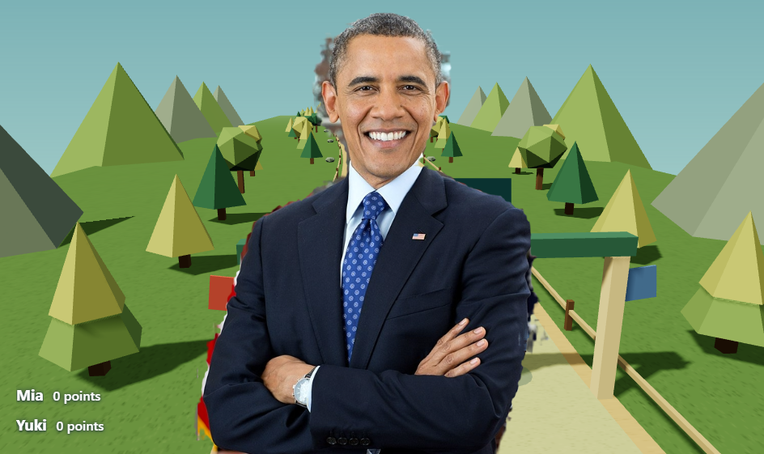

# Lightweight person-removal experiment

Restart Story Studio to load the new preload and camera protocol. In Control's **Camera** options, enable **Remove background · experimental**. It makes the area behind the person transparent, revealing the story/game. Green-screen keying and person removal are mutually exclusive in the controls. Disable removal to return to the original video; camera move/resize, off-screen cropping, mirroring and tracking continue to work.

This first experiment provides transparent removal. Background blur and replacement-image controls are not implemented yet. Brightness/contrast retain their existing behavior.

## Implementation and performance controls

- Local, unmodified MediaPipe landscape Selfie Segmenter float16 version 1: 250,177-byte model, 256×144 input. Existing tasks-vision runtime 0.10.32; no new dependency or cloud processing.
- One CPU worker, one frame in flight, no frame queue. Admission is capped at 12Hz (typically 10 masks/sec with a 30Hz camera render loop). Video and face tracking share the same camera stream.
- Slow inference backs off to 6Hz; five cheap samples allow recovery. Five consecutive jobs over 150ms stop the worker and report an error. Missing or older-than-400ms masks hide the camera output instead of showing the original room.
- The existing GPU shader composites the low-resolution confidence mask with linear filtering and a soft boundary. The shader updates at the existing video rate. The model does not use a GPU inference delegate.
- Private Control readings show mask updates/sec, processing milliseconds, mask age and camera redraw fps. These are not a whole-system GPU utilization measurement.
- Hidden pauses/releases person inference. Disabling removal releases its worker; turning the camera off releases all inference workers and the capture stream. Errors can be retried by toggling removal off/on.

## Measured native experiment

The actual model ran offline against Google's public portrait, moved through a synthetic 1280×720 webcam, over Hero Dash. Network requests were blocked. This tests the real worker/model/compositor and tracking, but does not reproduce physical-camera noise, hand movement, varied people or classroom thermals.

The combined phase sampled performance for 30 seconds after warm-up. CPU below is Electron's reported Presenter-process percentage, averaged across samples; it is not a claim about every customer's hardware. RAM is the Presenter process working set, including its worker threads, and is affected by prior mode switches and delayed garbage collection.

| Mode | Camera redraw fps | Camera frame p95 | Presenter CPU | Presenter working set, first → last |
|---|---:|---:|---:|---:|
| baseline | 30.0 | 39.1 ms | 2.48% | 138 → 141 MB |
| personRemoval | 30.0 | 40.9 ms | 3.57% | 302 → 518 MB |
| trackingOnly | 30.0 | 38.2 ms | 6.03% | 655 → 705 MB |
| personAndTracking | 30.0 | 41.2 ms | 6.97% | 751 → 747 MB |

At the end of the combined run: 10 masks/sec, 10.1ms average-smoothed processing time and about 30 camera redraws/sec. CPU was approximately one percentage point higher than tracking-only. UI animation-frame p95 remained 16.8ms across the phases.

Memory is a material cost: the combined Presenter working set settled near 747MB in this short run, versus roughly 141MB for the initial baseline. These sequential phases do not isolate the exact retained allocation of each feature. The combined app's total working set was about 1.55GB. Keep the feature optional; longer teaching-session and lower-end device tests are still needed. This is a promising prototype, not a performance guarantee or commercial-readiness claim.

## Verification

605 shared tests pass, including rate limiting, one-frame admission, stale rejection, adaptive recovery, overload shutdown, status validation and IPC authorization. Main/renderer builds and renderer type checking pass. Vite's existing chunk-size warning remains.

The native experiment passed real segmentation with tracking, bounded worker/frame counts, no second camera acquisition, error hiding without stopping capture, explicit restoration of original video, exclusive key-mode switching, Hidden/off cleanup and offline asset loading. Screenshot review confirms a person cutout over the game; edges and retained background patches remain imperfect. The existing Presenter crop/layer regression also passed. Focused review found no important lifecycle, privacy, authentication or resource issues.

[Native results and measurements](person-removal-evidence/results.json)

Run: `node scripts/person-removal-smoke.cjs` (downloads an upstream portrait only to a temporary test folder; set `STORY_STUDIO_FACE_FIXTURE` to test a local portrait).

## Licensing and assets

The exact model URL and SHA-256 are pinned in `public/person-removal/manifest.json`. The official [landscape model card](https://storage.googleapis.com/mediapipe-assets/Model%20Card%20MediaPipe%20Selfie%20Segmentation.pdf) identifies the model as Apache-2.0. A local copy of the card, full license text and notices are included alongside the model. Runtime notices remain with the existing face-tracking assets. Build preparation verifies both model hash and runtime version; all production resources load locally.

No deployment or installer was produced.
