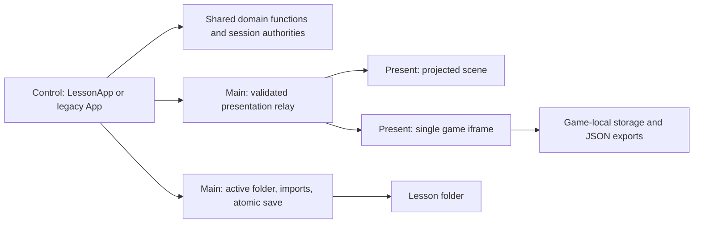

# Phase 6A — Architecture audit

Date: 2026-10-12. Baseline: `16ae31dc879ad3324a2d70bfdf8346fc3fe3d323`, branch `codex/presenter-camera-phase1`. Working tree was clean at the start. This report, proposed contracts, future implementation plan, and a read-only evidence script are the entire Phase 6A change. No production behavior, project format, branch, or user lesson was changed; no commit or push was made.

## Recommendation

Extend the existing scene lesson model and shared services incrementally. Keep the legacy reader/writer as a compatibility boundary. Start 6B with a shared **view over the existing asset arrays**, typed dependency enumeration, and project-scoped resolution. Do not create another independently writable asset store, replace the renderer, or automatically convert legacy lessons.

There is useful Core infrastructure already, but no single complete Core service. Shared pure domain functions own parts of the rules; Control holds the active document/session; Electron main owns files and the presentation relay. Preserve this physical arrangement while making its interfaces authoritative. Game state can remain local to its single Present iframe, but authored configuration and accepted educational results must eventually pass through Core.

Related deliverables:

- [Proposed contracts and migration rules](phase6a-contracts.md)
- [File-by-file Phase 6B plan and later phase gates](superpowers/plans/2026-10-12-phase6b-media-registry.md)
- [Fresh read-only evidence](phase6a-evidence/audit.json)
- Reproduce: `npm test`, `npm run check:games`, then `node scripts/phase6a-audit.mjs` from the repository root.

## 1. Current document and storage boundaries

| Boundary | Actual format/owner | Consequence |
| --- | --- | --- |
| Default workspace | `src/renderer/main.tsx` selects `LessonApp`; `?legacy=1` selects `App` | These are separate document workflows, not two views of one converted document. |
| Legacy project | `src/shared/types.ts::ProjectData`, versions 1–4; folder `project.json` plus `assets/` | Slides, sections, three Boost sequences, A/B libraries, optional Card V2, reward configuration AND student scores/relic progress. No stable project ID in this type. |
| Scene lesson | `src/shared/lesson/model.ts::LessonProject`, `format: story-studio-scene`, version 1 | Stable lesson ID; shared scenes, `story`/`activation` sequences, cards, library, sets, assets and bins. No Challenge/Mastery configuration slots or adventure identity. |
| Main-process authority | `src/main/main.ts:58`, `activateProjectCandidate`, `withProjectWrite`; `src/main/lessonPersistence.ts` | One active folder/format; prepare then activate tokens; imports exclude saves/switches; atomic JSON publication. A prepared open does not redirect the active project. |
| Save As | `main.ts::copyProjectFolder`, both save handlers | Copies folder entries except current/temp project JSON into an empty destination, then publishes JSON. It does not calculate dependency closure or capture game browser storage. |
| Roster/settings | `main.ts::settingsPath`, `readStoryStudioSettings`; `story-studio-settings.json` in Electron userData | App-level identities and audio preferences, outside project folders. Legacy renderer also uses a localStorage roster fallback. |
| Game saves | Language Snake localStorage/download; Final Boss localStorage/download | Not included by either lesson writer. Returning to the lesson does not integrate these saves. |

`normalizeProjectData` upgrades the **in-memory** legacy view to version 4 and adds/normalizes sections, Boost entries, students and relic defaults. `LegacyCardPersistence` retains raw/baseline card fields to restore untouched legacy authoring when saving. It is not a whole-document migration/backup service. `parseLessonProject` clones and calls `migrateSections`, which generates section identities for older scene lessons without sections. Neither open handler writes the source, but a later explicit Save may persist the normalized form. No automatic preserved backup is made by the atomic writer; atomic replacement is not a backup.

`parseLessonProject` validates known references, limits and geometry but preserves unknown top-level fields in its returned clone (fresh characterization test). In contrast, Card V2 validation rejects unrecognized object keys. Future extensions therefore need versioned parsers and explicit export construction; adding data to an arbitrary object does not establish portability or privacy guarantees.

## 2. Media ownership, identifiers and reference forms

`AssetItem` (`src/shared/types.ts:69`) already supplies a stable ID, relative path, UUID storage filename, original name, media type, byte size, import timestamp, optional bin ID and display/reference labels. `MediaBin` has a stable ID, name and parent ID. No content digest, media dimensions/duration, semantic entity identity, adventure scope, source/derived relationship, or versioned transformations are defined.

`src/main/mediaImportService.ts::importProjectMedia` recursively imports files/directories, rejects symbolic links, creates nested bin identities, copies supported files under `assets/<uuid>.<ext>`, and returns partial failures. Every import creates a fresh ID/copy; equal bytes are not deduplicated. The main wrapper omits generated slides for scene lessons. Import registration happens separately in renderer/domain functions (`mergeLessonMediaImport`, `registerPoolImport`, `applyMediaImportToProjectData`). Uncommitted imports can therefore leave unreferenced files; a registry must not interpret them as disposable.

Two other import paths matter: `main.ts:1005` separately copies audio to UUID files, and `main.ts:1044` copies bubble PNGs to name-based `assets/bubbles/` paths, returning a path rather than an `AssetItem`. A registry built only from `assets[]` will miss those bubble dependencies. Preserve their existing paths and bytes.

| Authored reference | Current consumers | Registry implication |
| --- | --- | --- |
| Asset IDs | Slides; scene background/image/audio; Card V2 face `imageAssetId`; ACard `background.imageId`; BCard face `imageId` and `audioRefId`; badge/relic images | Preserve ID exactly. Traverse definitions as well as placements. |
| URLs | Legacy `AudioClip.url`, `AudioCue.targetUrl`, section background CSS | Parse known fields, decode once and match exactly; do not substring-search arbitrary text. |
| Paths | Bubble templates/custom images; movement GIF/jingle paths | Classify project-local unregistered dependencies separately from registry records. |
| Built-in paths | `renderer/movement/builtinMedia.ts`, bundled game assets | Some `assets/...` values actually resolve to Vite-bundled engine assets, not project files. Require an explicit built-in mapping. |
| Data/remote URLs | Final Boss image/portrait/video/cutscene strings; uploaded Snake background/audio | Require module adapters and explicit packaging policy; these are outside today's pool. |

`renderer/mediaUrls.ts::toMediaUrl` URL-encodes paths as `media://assets/...`; `visualMedia.ts` adds a render-only `sceneScope` query. Main's `resolveMediaPathFromUrl` joins host+pathname against the **current active folder** and checks lexical containment. It does not verify asset membership, bind `sceneScope` to a folder generation, or verify realpath containment against symlinks in an already-existing project. Keep the path compatibility reader, but do not mistake the cache query for an access lease. Future registry URLs must reject stale project generations and escaped real paths.

## 3. Adventure and Activation

In `LessonApp`, the visible Adventure and Discovery/Activation routes correspond to `story` and `activation`. They share one `LessonProject.assets`, `mediaBins`, `cards` and `scenes`. `SceneInspector` selects pool IDs for face images and backgrounds. `projectScene` accepts a resolver and produces the same `ScenePlan` for Edit, teacher preview and Present. `SceneAudioOwner` accepts an asset resolver and fences late loads. These are strong existing integration seams.

In legacy `App`, story slides and Boost/ACard/BCard/Card V2 authoring share `ProjectData.assets`, but resolve media through several helpers and inline `.find()` calls. The legacy Media Pool is not the sole owner of these bytes; it is a UI over the project. `CardSystemProvider` mirrors supplied A/B libraries in refs to avoid stale callbacks; it is not independent permanent storage. Card V2 supplies authored/runtime separation and a token-checked `CardSessionAuthority`.

The two pool implementations have **different usage semantics**:

- `shared/mediaPool.ts::mediaUsage` recursively searches non-registry strings for ID/path/URL matches, including substring matches. This can count unrelated text and miss encoded URLs or external stores.
- `renderer/lesson/LessonMediaPool.tsx::lessonAssetUsage` counts scene background/audio/image uses and card faces per placed card. An image on an unplaced library card returns zero; the fresh audit script confirms it. Linked scenes count once, card placements can count the same face repeatedly.

Neither is safe as a packaging/deletion oracle. Separate definition dependency edges, placement counts and runtime telemetry. All authored definitions, including unplaced cards and unused pool media, must survive normal Save/Save As.

## 4. Challenge, Mastery and Final Boss

`shared/gameHost.ts` contains a fixed bundled registry: Language Snake in `game` (UI label Challenge), Final Boss Hero in `mastery`. Mastery is currently a launcher for Final Boss, not its own authored lesson schema. `GameRegistration` has titles, entries, sections and mode names, but no version, configuration schema, asset declaration, result contract or reward capabilities.

`GameHost.tsx` owns lifecycle controls and forwards keyboard input. `PresentGame.tsx` mounts the only game iframe; it checks frame source, origin and instance ID and handles ready/error/input messages. `main/presentWindow.ts` authenticates Control/Present roles, relays snapshots/inputs, and reports game closure/reload/crash. The existing launch target carries only game/instance/occurrence IDs. There is no authored configuration transfer, registry asset port, educational completion event or Core reward decision channel.

### Language Snake

`games/language-snake/App.jsx:678` serializes version 1 setup, question text, controls, background image and gameplay state (players, scores/crowns, foods, phase, turn and cooperative state). It uses `story-studio-language-snake-save-v1`, auto-loads the device save, and downloads/uploads separate JSON. Images are FileReader data URLs. Custom sounds/music are FileReader data URLs held by its effects runtime but are **absent from `buildSavePayload`**; the UI describes them as session-only. A new package cannot recover audio that was never saved. Do not promise retroactive completeness.

### Final Boss

`games/final-boss-hero/src/store/battleStore.ts` is a separate Zustand authority. It stores encounter config and a card library, selected mini-game/hero, battle/scores/effects and intermission state. It supports namespaced localStorage saves (`encounter.v1`, save index and active-save key); current state snapshots carry version 2 and older encounter payloads remain loadable.

`types/projectFile.ts` defines a distinct `final-boss-hero-project` version 1 export with `project: { encounter, cardLibrary }` and a `session` block. `EditModeShell.tsx` manages JSON downloads/import and FileReader data-URL media. `types/game.ts` stores card `image/frontImage/backImage`, fighter portraits/videos and cutscenes as strings, not pool IDs. Sample content includes remote `placehold.co` URLs. Import sanitation can substitute defaults/sample cards, so it must not be used silently as a lossless migration function.

`miniGames/types.ts` and `miniGames/registry.ts` already supply a small bundled plugin interface (component, encounter/progress/score props, `onComplete`). Reuse it behind a Story Studio adapter; do not turn every internal mini-game into a new external loader. `completeMiniGame` currently updates game-local score/battle state, not Story Studio student records. Distinguish these transient game mechanics from permanent rewards.

## 5. Core / Control / Present and competing state

Core currently means several tested components, not a `Core` singleton. Examples: lesson commands/session/projection; `PresentationSession`; `CardSessionAuthority`; `RewardResultCore`; `PresentSnapshotRelay`. Control holds authored revisions and undo via `ProjectHistory`; Present receives whitelisted visual plans. Present snapshot generation/revision retirement and game instance filtering are reusable safeguards, not a durable progression ledger.

Competing ownership to resolve in controlled steps:

1. Two supported document models and two renderer roots; retain format adapters rather than merging all state immediately.
2. Three card representations: legacy A/B, Card V2/scene cards, and Final Boss cards. Map references at adapter boundaries; preserve module-specific fields.
3. Array registries, two usage scanners, inline URL builders, separate audio import and unregistered bubble paths.
4. Control document/session state versus game-local authored configuration and device saves. A lesson Save currently cannot observe an iframe edit.
5. App roster, legacy episode scores/relic progress, new lesson session scores, game-local players/scores, and legacy live-session localStorage recovery.
6. `file.data` (saved revision), current project, history and refs in LessonApp are deliberate revision snapshots; replacing them with independently writable stores would introduce a bug rather than remove duplication.

## 6. Rewards, relics, students and content coupling

The roster (`StudentRosterEntry`) has stable identity, name, archive flag and timestamps, outside lessons. Legacy `SparkStudent` records include counters and names inside `ProjectData`; `RelicSystem` combines definition/presentation configuration with `studentProgress`. `useRewardPresentation` uses `RewardResultCore` for session deduplication, then updates project data and dirty state. This conflicts with the Phase 6 permanent-progress boundary, but those saved values must be preserved until an explicit import/mapping operation is approved.

Scene lessons improve the separation: `LessonSession.rewards` contains temporary students/scores, visible effects and applied event IDs; `LessonRewardControls` initializes from the global roster or Class and can add temporary participants. Scores are not authored lesson data. Both reward implementations deduplicate within a session, not across restarts. No general inventory, adventure-scoped progression repository, or durable accepted-result ledger was found in the reviewed application paths.

Engine/content coupling is concrete: `shared/movement.ts` and `renderer/movement/builtinMedia.ts` name Mia and Yuki and import their pose GIFs; `shared/relics.ts` defaults to Echo relic stage titles; `sparkRewards.ts` fixes the four reward variants; Final Boss ships its sample encounter/fighters/rewards. Move content-specific defaults into bundled, versioned adventure packs in 6G, retaining an explicit legacy compatibility mapping. Generic animation and scoring mechanics remain engine capabilities. Do not infer semantic identity from filenames or assume two characters named Yuki are the same.

## 7. Components to reuse

| Existing seam | Reuse |
| --- | --- |
| `lesson/model.ts`, commands, validation, sections, session | Authoritative authored scene model and independent runtime; stable occurrence IDs and return-to-story behavior. |
| `ProjectHistory`, renderer latest-revision guards | Dirty tracking and undo for authored data only. |
| `mediaImportService.ts`, bin merge helpers | File copying, partial failure reports and nested bin identity. |
| `lessonPersistence.ts`, main folder locks/atomic writer, `LegacyCardPersistence` | Persistence safety and untouched legacy card retention. |
| `projectScene`, `buildCardV2FacePlan`, `SceneSurface`, `StudentSceneBoundary` | Shared render projection; no teacher notes/hidden answers in passive Present snapshots. |
| `presentWindow.ts`, preload APIs, snapshot relay, media bridge | Authenticated transport, stale-message rejection, one live output and retained media ownership. |
| `SceneAudioOwner`, existing mixer | Asset-ID resolution and cancellation without creating another decoder/mixer owner. |
| `RewardResultCore`, `lesson/rewards`, reward projection | Reducer and dedupe behavior as starting points, with durable storage added separately in 6F. |
| Game registry, host bridges, Final Boss mini-game registry | Bundled adapters and lifecycle cleanup; retain native game mechanics. |

## 8. Fresh verification and its limits

| Check | Result |
| --- | --- |
| `npm test` | **440 passed, 0 failed**. Includes real-main IPC/filesystem save/open, import/Save As exclusion, format fencing, failed atomic write recovery, actual renderer-boundary tests, rewards and projection tests. Electron UI boundaries are mocked in persistence tests; this is not a native UI smoke run. |
| `npm run check:games` | **33 passed, 0 failed**, plus Final Boss TypeScript check. Includes input/host bridges, project roundtrip, editor import and layout calculations. |
| `node scripts/phase6a-audit.mjs` | Six production project opens through the real main loader; no activation/save calls; all before/after SHA-256 values match. Asset records unchanged; characterization checks passed. |

| Production episode | Version | Registered files present | Saved students | Saved relic progress records |
| --- | --- | ---: | ---: | ---: |
| 1 | 4 | 169/169 | 1 | 1 |
| 2 | 4 | 339/339 | 1 | 0 |
| 3 | 4 | 216/216 | 3 | 1 |
| 4 | 4 | 174/174 | 1 | 1 |
| 5 | 4 | 118/118 | 1 | 1 |
| 6 | 4 | 100/100 | 3 | 1 |

All six have legacy A/B libraries, no saved Card V2 module, no media bins and no duplicate asset IDs within the document. The **1,116** file checks establish registered-file existence, not media decoding, hash identity, every embedded/path-only dependency, or cross-episode deduplication. Source media bytes were not hashed. No real student names or scores are emitted by the audit script.

No fresh native Electron visual/gameplay E2E or hardware check was run for this documentation-only phase. Existing native smoke scripts (`game-host-smoke.cjs`, `game-media-smoke.cjs`, `final-boss-smoke.cjs`) are future integration gates, not claimed current evidence. Existing `packaging.test.ts` checks Vite relative URLs; it does **not** test portable lesson dependency closure. Historical screenshots/reports are contextual evidence only.

## 9. Migration risks and required controls

| Risk | Required control |
| --- | --- |
| Silent loss of old cards, fields, scene transforms or sequences | Preserve original bytes and media tree; per-format adapters; golden fixtures; exact ID/reference comparisons; explicit conversion copy and report. |
| Losing students while removing episode-owned progress | Preserve original legacy lesson and separately export/import progress with teacher identity mapping. Never match solely on display name or automatically sum conflicting totals. |
| Library media classified unused | Typed dependency walkers over all definitions; placement counts separate; no automatic garbage collection. |
| Game state omitted from lesson Save | Versioned authored-config adapter in 6D and dependency packaging in 6E; explicitly separate optional run checkpoints from lesson content. |
| Browser saves bleed between episodes | Hosted games initialize from Core configuration and disable implicit device-save adoption; standalone mode remains supported. |
| Missing source media/remote URL/session-only audio | Preflight with owner+field diagnostics; require repair/materialization before declaring portable success. Do not substitute sample content. |
| Same filename across projects, late loads after switch | Project activation lease, exact lookup, retirement on activation/Save As and realpath containment. |
| New schema destroys unknown extensions | Read-only unsupported mode or refusal; preserve originals; never downgrade on save. Strict module schemas, explicit extension envelopes. |
| Duplicate score/reward/relic events after reload | Durable idempotent acceptance transaction in 6F, scoped to run and participants; animations do not reapply progression. |
| Treating a folder copy as a backup/portable archive | Separate explicit migration backup manifest from package export; staging, verification, atomic publication, rollback test. |
| Too much work hidden in 6B | 6B changes only shared lookup/import/usage and safe resolution; game contracts, derived assets, content packs and durable progression have separate gates. |

## 10. Smallest integration proof

**6B proof:** Import one image into a nested bin once; use its unchanged asset ID as a Story background and Activation card face. Resolve Edit/Teach/Present through the shared registry. Add a library-only card reference and verify it remains a dependency. Save As to a new folder, close/reopen, and verify both scenes, bin IDs, one physical image, and unchanged original source. Switch to a second lesson with the same relative filename but different bytes and reject stale resolution requests. Repeat legacy shared-image/reference loading without conversion.

**Full Phase 6 proof, after separate authorizations:** One synthetic adventure/episode uses a single source character image as a Story background, derived Activation crop, Snake background and Final Boss illustration. Configure questions and a versioned reward/relic definition; save one portable project; open it in a fresh profile offline. Bind two existing student identities, complete an activity, approve a reward once, replay its event and verify no duplicate grant. Reopen another episode/adventure: student identity persists, progress remains correctly scoped, and package JSON contains no roster, totals or permanent inventory. A second adventure can contain a different Yuki without an identity collision. This is an acceptance target, not a feature delivered in 6A.

## Phase 6A changed files

| New file | Purpose |
| --- | --- |
| `docs/phase6a-architecture-audit.md` | Repository findings, reuse/migration risks, verification results and integration proof. |
| `docs/phase6a-contracts.md` | Proposed authority, media, catalog, module, packaging and progression contracts; migration protocol. |
| `docs/superpowers/plans/2026-10-12-phase6b-media-registry.md` | File-level 6B tasks, verification/compatibility gates and later phase overview. |
| `scripts/phase6a-audit.mjs` | Read-only production JSON/asset inventory and two source-behavior characterizations; requires `npm test` compiled output. |
| `docs/phase6a-evidence/audit.json` | Reproducible source hashes, inventory counts and characterization results; no student names/scores. |

Phase 6A stops here. Phase 6B–6G require separate starts.
