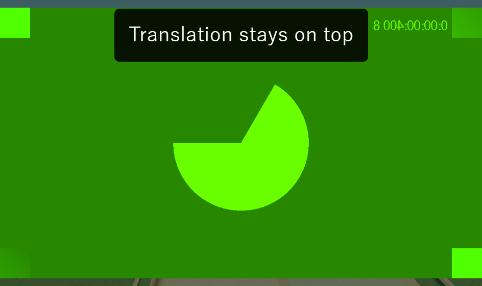
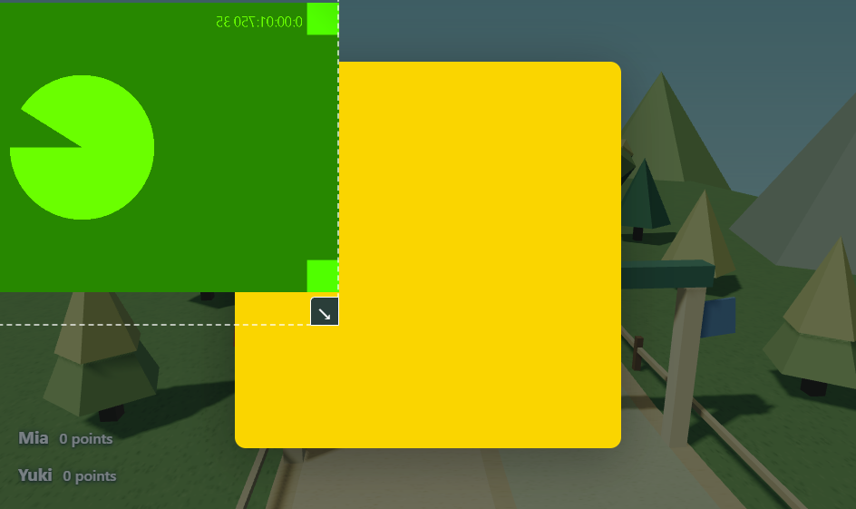

# Presenter layers and camera edge cropping

Presenter now explicitly stacks all content in this order, from front to back:

1. Translation captions.
2. Camera video, chroma-key output, tracking and camera edit handles.
3. Student roster and all lesson/game content, question images and reward effects.

Hero Dash question images retain their normal centered, contained size when the camera or subtitles appear. Those overlays can cover the image, but do not shrink it.

## Camera editing

Enable **Move / resize in Presenter** in Control's Camera options. All four corners now resize the camera; each keeps the opposite corner anchored. Arrow keys on a corner also resize it. Drag the video to move it past any Presenter edge. The off-screen portion is cropped by the Presenter viewport, so only part of a face or keyed figure can remain visible.

The dotted rectangle follows the actual camera bounds, even when some bounds extend beyond the viewport. Camera dimensions can range from 3% to 400% of the Presenter; a small visible strip remains for recovery. Corner handles shrink for tiny video rectangles so their middle remains draggable. This uses proportional coordinates and works with chroma key. **Reset camera placement** in Control recovers the lower-right default at any time. Turn editing off to hide the handles and pass pointer input through.

Camera capture is preserved during layout changes. Output is clipped at the Presenter edges without creating scrollbars.

## Verification

- 602 shared tests passed; focused geometry/schema/image-sizing checks passed (22 tests).
- Main and renderer builds and renderer type checking passed. Existing Vite chunk-size warnings remain.
- Native Electron checks verify unchanged image dimensions, actual overlapping layer order, all four anchored corner drags, off-screen cropping on all edges, chroma, oversized/tiny rectangles, reset and portrait layout.
- Focused review found no important issues.

[Native results](presenter-crop-evidence/results.json)

Run: `node scripts/presenter-crop-smoke.cjs`

Tests use a simulated camera. No installer or deployment was produced.
