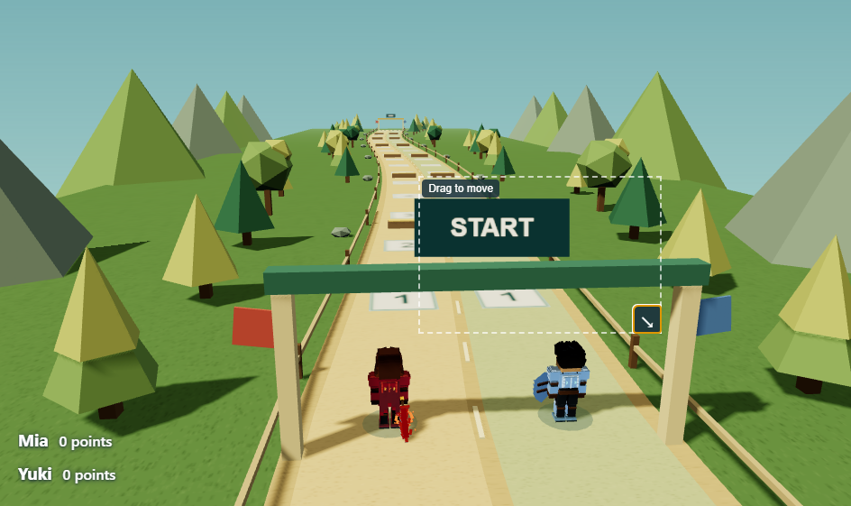
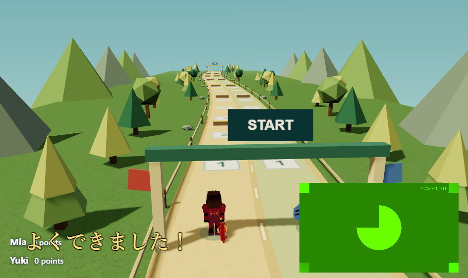

# Presenter layout, caption styling and Hero Dash polish

Restart Story Studio to load the updated camera and caption IPC connections.

## Camera

In Control's Camera options, enable **Move / resize in Presenter**. Drag the video to place it anywhere inside Presenter; drag its bottom-right handle to resize its rectangle. Arrow keys on the handle also resize. This applies to ordinary video, chroma key and the tracking overlay. Turn editing off for teaching so pointer input passes through to the presentation. **Reset camera placement** restores the lower-right preset; choosing a preset also clears free placement.

Placement uses viewport proportions, remains inside the window, and survives camera off/on during the session. Layout changes preserve the running capture session. Camera placement remains independent of race zoom.

## Captions

Open Translation → **Caption appearance**. Options include Japanese-compatible font families, size, text color, bold, dark outline, alignment, top/bottom placement, edge spacing, line spacing, maximum width, background color and opacity. Set background opacity to **0** for transparent text. Changes update an already published caption; no new translation is required. Appearance settings are available while translation is off and apply to subsequent published captions.

Font choices use installed system fonts with Japanese fallbacks. Layout and appearance settings are session settings; they are not written into review collections.

## Media and game

Camera views now sits immediately below the race teaching controls. Browse images is collapsible and starts closed; Prepared questions starts open. Follow Red/Blue selects an independent orbit target, so awarding the other racer does not redirect orbit. Side View and Overview orbit around both racers; Side View also frames both when they are far apart.

- Use visible checkboxes, Ctrl/Cmd-click or Shift-click to select a batch of review images. **Prepare selected (N)** adds them together. The Prepared questions panel also has a batch-add button and accepts a dragged selection. Each image becomes its own editable question card; existing cards and notes remain intact.
- Presenter branding, course/level text, leader text and feedback banners have been removed. Only racer names and points remain as transparent stacked rows at the bottom left. Teacher status and progress remain in Control.
- All courses now use stronger directional sunlight, reduced ambient fill and real soft tree/character shadows. One bounded 1024-pixel shadow map follows the active racer. Shadow resources are released when a course closes.

## Verification

599 shared tests passed. The focused camera/caption suite passed again after adding layout authentication checks (9 tests), and 62 game checks passed. Main and renderer builds and renderer type checking passed; the existing Vite chunk-size warning remains.

The expanded native smoke covers checkbox batch dragging into editable cards, camera dragging and resizing, chroma-key placement, keyboard resize, editing off pointer behavior, live caption styling, transparent bottom-left HUD, media persistence, question layout, race controls, zoom, viewport resizing and three-course transitions. See [native results](hero-dash-refinement-evidence/results.json).

Run: `node scripts/hero-dash-refinement-smoke.cjs --visual-phase --presenter-layout`

Native tests use a simulated camera and published caption text. Physical camera/microphone operation and older-laptop frame rates were not measured. No deployment or installer was produced.

